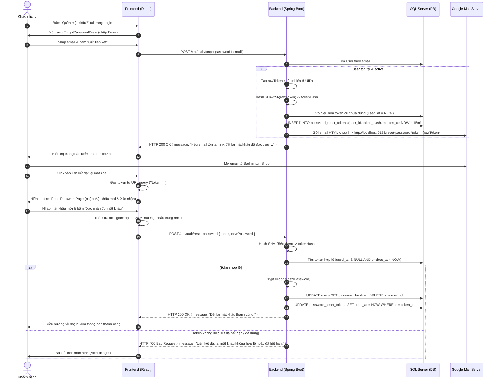

# KẾ HOẠCH TRIỂN KHAI TÍNH NĂNG QUÊN MẬT KHẨU (FORGOT & RESET PASSWORD)
> **Phân hệ:** Authentication & User Security  
> **Dự án:** SBA301 Badminton Shop (SE1986-JV)  
> **Kiến trúc áp dụng:** Spring Boot 4.x / Java 21 + Spring Data JPA + Spring Security + Spring Boot Starter Mail + React 19 / React-Bootstrap  
> **Phương án thực thi:** Tối giản – Chuẩn 2 Endpoints, xác thực email qua Google SMTP, validate form trực tiếp bằng React State thuần (không dùng Zod)  
> **File lưu trữ:** `documents/module/auth/forgot_password_plan.md`

---

## 1. TỔNG QUAN & MỤC TIÊU TRIỂN KHAI

### 1.1. Hiện trạng Codebase
1. **Database:** Trong file [`badmintonshop.sql`](file:///d:/SBA301_BadmintonShop_SE1986-JV/badmintonshop.sql#L48-L57), bảng `password_reset_tokens` đã có sẵn cấu trúc chuẩn:
   - `id`: Khóa chính tự tăng (`BIGINT IDENTITY(1,1)`).
   - `user_id`: Khóa ngoại tham chiếu đến `users(id)` (`ON DELETE CASCADE`).
   - `token_hash`: Chuỗi lưu mã băm bảo mật của token (`VARCHAR(255)`).
   - `expires_at`: Thời điểm hết hạn token (`DATETIME2(0)`).
   - `used_at`: Thời điểm token đã được sử dụng (`DATETIME2(0)`), phòng chống tấn công Replay Attack.
   - `created_at`: Thời điểm tạo bản ghi (`DATETIME2(0)`).
2. **Backend:**
   - Chưa có entity JPA `PasswordResetToken` và repository tương ứng.
   - Chưa tích hợp `spring-boot-starter-mail` trong [`pom.xml`](file:///d:/SBA301_BadmintonShop_SE1986-JV/backend/badmintonshop/pom.xml).
   - [`SecurityConfig.java`](file:///d:/SBA301_BadmintonShop_SE1986-JV/backend/badmintonshop/src/main/java/fu/se/badmintonshop/config/SecurityConfig.java) đang yêu cầu xác thực với `/api/auth/**` (trừ `login`, `register`, `logout`).
   - [`AuthController.java`](file:///d:/SBA301_BadmintonShop_SE1986-JV/backend/badmintonshop/src/main/java/fu/se/badmintonshop/modules/auth/controller/AuthController.java) chưa có 2 endpoint tiếp nhận quên mật khẩu và đặt lại mật khẩu.
3. **Frontend:**
   - [`LoginPage.jsx`](file:///d:/SBA301_BadmintonShop_SE1986-JV/frontend/src/modules/auth/pages/LoginPage.jsx) chưa có liên kết "Quên mật khẩu?".
   - Chưa có trang `ForgotPasswordPage.jsx` và `ResetPasswordPage.jsx`.
   - [`public.routes.jsx`](file:///d:/SBA301_BadmintonShop_SE1986-JV/frontend/src/app/router/public.routes.jsx) chưa đăng ký route cho 2 trang này.

### 1.2. Định hướng tối giản theo yêu cầu
- **Đúng 2 Endpoints duy nhất:**
  1. `POST /api/auth/forgot-password` (Nhận email -> tạo token & gửi link reset qua email).
  2. `POST /api/auth/reset-password` (Nhận token + mật khẩu mới -> verify token và đổi mật khẩu trong 1 lần gọi).
- **Không dùng Zod validation ở Frontend:** Sử dụng state React thuần và kiểm tra điều kiện đơn giản (`password.length >= 6`, `password === confirmPassword`), đồng bộ với phong cách viết tinh gọn của `LoginPage.jsx`.
- **Bảo mật cơ bản:** Băm SHA-256 token trước khi lưu DB; token có hạn 15 phút; vô hiệu hóa token cũ sau khi dùng.

---

## 2. KIẾN TRÚC & LUỒNG HOẠT ĐỘNG (SEQUENCE DIAGRAM - 2 ENDPOINTS)



---

## 3. THIẾT KẾ CƠ SỞ DỮ LIỆU & JPA

### 3.1. Bảng `password_reset_tokens` (Có sẵn trong `badmintonshop.sql`)
```sql
CREATE TABLE password_reset_tokens (
  id          BIGINT IDENTITY(1,1) PRIMARY KEY,
  user_id     BIGINT NOT NULL,
  token_hash  VARCHAR(255) NOT NULL,
  expires_at  DATETIME2(0) NOT NULL,
  used_at     DATETIME2(0) NULL,
  created_at  DATETIME2(0) NOT NULL DEFAULT SYSDATETIME(),
  FOREIGN KEY (user_id) REFERENCES users(id) ON DELETE CASCADE,
  INDEX idx_prt_user (user_id)
);
```

### 3.2. JPA Entity: `PasswordResetToken.java`
* **Vị trí file:** `backend/badmintonshop/src/main/java/fu/se/badmintonshop/modules/auth/entity/PasswordResetToken.java`
```java
package fu.se.badmintonshop.modules.auth.entity;

import jakarta.persistence.*;
import lombok.*;

import java.time.LocalDateTime;

@Entity
@Table(name = "password_reset_tokens")
@Getter
@Setter
@NoArgsConstructor
@AllArgsConstructor
@Builder
public class PasswordResetToken {

    @Id
    @GeneratedValue(strategy = GenerationType.IDENTITY)
    private Long id;

    @ManyToOne(fetch = FetchType.LAZY, optional = false)
    @JoinColumn(name = "user_id", nullable = false)
    private User user;

    @Column(name = "token_hash", nullable = false, length = 255)
    private String tokenHash;

    @Column(name = "expires_at", nullable = false)
    private LocalDateTime expiresAt;

    @Column(name = "used_at")
    private LocalDateTime usedAt;

    @Column(name = "created_at", insertable = false, updatable = false)
    private LocalDateTime createdAt;

    public boolean isExpired() {
        return LocalDateTime.now().isAfter(this.expiresAt);
    }

    public boolean isUsed() {
        return this.usedAt != null;
    }
}
```

### 3.3. JPA Repository: `PasswordResetTokenRepository.java`
* **Vị trí file:** `backend/badmintonshop/src/main/java/fu/se/badmintonshop/modules/auth/repository/PasswordResetTokenRepository.java`
```java
package fu.se.badmintonshop.modules.auth.repository;

import fu.se.badmintonshop.modules.auth.entity.PasswordResetToken;
import fu.se.badmintonshop.modules.auth.entity.User;
import org.springframework.data.jpa.repository.JpaRepository;
import org.springframework.data.jpa.repository.Modifying;
import org.springframework.data.jpa.repository.Query;
import org.springframework.data.repository.query.Param;
import org.springframework.stereotype.Repository;

import java.time.LocalDateTime;
import java.util.Optional;

@Repository
public interface PasswordResetTokenRepository extends JpaRepository<PasswordResetToken, Long> {

    Optional<PasswordResetToken> findByTokenHash(String tokenHash);

    @Modifying
    @Query("UPDATE PasswordResetToken p SET p.usedAt = :now WHERE p.user = :user AND p.usedAt IS NULL")
    void invalidateAllActiveTokensForUser(@Param("user") User user, @Param("now") LocalDateTime now);
}
```

---

## 4. CHI TIẾT THIẾT KẾ BACKEND (SPRING BOOT)

### 4.1. Bổ sung Dependency `pom.xml`
```xml
<dependency>
    <groupId>org.springframework.boot</groupId>
    <artifactId>spring-boot-starter-mail</artifactId>
</dependency>
```

### 4.2. Cấu hình `application.properties`
Thêm cấu hình gửi mail qua SMTP và thời gian sống của token:
```properties
# =====================================================================
# Mail Configuration (Google SMTP)
# =====================================================================
spring.mail.host=${SPRING_MAIL_HOST:smtp.gmail.com}
spring.mail.port=${SPRING_MAIL_PORT:587}
spring.mail.username=${SPRING_MAIL_USERNAME:}
spring.mail.password=${SPRING_MAIL_PASSWORD:}
spring.mail.properties.mail.smtp.auth=true
spring.mail.properties.mail.smtp.starttls.enable=true
spring.mail.properties.mail.smtp.starttls.required=true
spring.mail.properties.mail.smtp.connectiontimeout=5000
spring.mail.properties.mail.smtp.timeout=5000
spring.mail.properties.mail.smtp.writetimeout=5000

app.auth.reset-token-ttl-minutes=${APP_AUTH_RESET_TOKEN_TTL_MINUTES:15}
```

### 4.3. Tạo DTOs (Request)
1. `ForgotPasswordRequest.java` (`modules/auth/dto/request`):
   ```java
   package fu.se.badmintonshop.modules.auth.dto.request;

   import jakarta.validation.constraints.Email;
   import jakarta.validation.constraints.NotBlank;
   import lombok.*;

   @Getter
   @Setter
   @NoArgsConstructor
   @AllArgsConstructor
   @Builder
   public class ForgotPasswordRequest {
       @NotBlank(message = "Email không được để trống.")
       @Email(message = "Địa chỉ email không đúng định dạng.")
       private String email;
   }
   ```
2. `ResetPasswordRequest.java` (`modules/auth/dto/request`):
   ```java
   package fu.se.badmintonshop.modules.auth.dto.request;

   import jakarta.validation.constraints.NotBlank;
   import jakarta.validation.constraints.Size;
   import lombok.*;

   @Getter
   @Setter
   @NoArgsConstructor
   @AllArgsConstructor
   @Builder
   public class ResetPasswordRequest {
       @NotBlank(message = "Mã token không được để trống.")
       private String token;

       @NotBlank(message = "Mật khẩu mới không được để trống.")
       @Size(min = 6, message = "Mật khẩu phải có ít nhất 6 ký tự.")
       private String newPassword;
   }
   ```

### 4.4. Dịch vụ gửi Email: `EmailService`
* **Vị trí:**
  - `fu.se.badmintonshop.modules.auth.service.EmailService`
  - `fu.se.badmintonshop.modules.auth.service.impl.EmailServiceImpl`
* **Nhiệm vụ:**
  - Sử dụng `JavaMailSender` và `MimeMessageHelper`.
  - Tạo template HTML gửi link reset: `${shop.frontend-url}/reset-password?token={rawToken}`.
  - Xử lý gửi thư an toàn, ghi log thông tin (trong môi trường dev có log link ra console để test nhanh nếu mạng chập chờn).

### 4.5. Nâng cấp `AuthService` & `AuthServiceImpl`
Bổ sung đúng 2 hàm:
```java
void forgotPassword(ForgotPasswordRequest request);
void resetPassword(ResetPasswordRequest request);
```

**Thuật toán xử lý:**
1. **`forgotPassword(request)`**:
   - Chuẩn hóa email: `trim().toLowerCase(Locale.ROOT)`.
   - Tìm user theo email. Nếu không tìm thấy: chỉ ghi log info và return (tránh lộ thông tin email).
   - Nếu user bị khóa -> ném lỗi `BAD_REQUEST`.
   - Sinh token ngẫu nhiên: `String rawToken = UUID.randomUUID().toString()`.
   - Mã hóa SHA-256: `String tokenHash = hashToken(rawToken)`.
   - Vô hiệu hóa token cũ: `passwordResetTokenRepository.invalidateAllActiveTokensForUser(user, LocalDateTime.now())`.
   - Lưu `PasswordResetToken` mới với hạn 15 phút.
   - Gửi email kèm link `${shop.frontend-url}/reset-password?token=` + `rawToken`.
2. **`resetPassword(request)`**:
   - Băm SHA-256 `request.getToken()`.
   - Tìm trong `PasswordResetTokenRepository`.
   - Nếu không tìm thấy, hoặc `isUsed()`, hoặc `isExpired()`:
     - Ném `ResponseStatusException(HttpStatus.BAD_REQUEST, "Liên kết đặt lại mật khẩu không hợp lệ hoặc đã hết hạn.")`.
   - Lấy `User` từ token.
   - Cập nhật: `user.setPasswordHash(passwordEncoder.encode(request.getNewPassword()))`.
   - Đánh dấu: `token.setUsedAt(LocalDateTime.now())`.
   - Lưu user & token.

### 4.6. Cập nhật `AuthController.java` (Đúng 2 Endpoints)
```java
@PostMapping("/forgot-password")
public ResponseEntity<Map<String, String>> forgotPassword(@Valid @RequestBody ForgotPasswordRequest request) {
    authService.forgotPassword(request);
    return ResponseEntity.ok(Map.of("message", "Nếu địa chỉ email tồn tại trong hệ thống, hướng dẫn đặt lại mật khẩu đã được gửi đến hộp thư của bạn."));
}

@PostMapping("/reset-password")
public ResponseEntity<Map<String, String>> resetPassword(@Valid @RequestBody ResetPasswordRequest request) {
    authService.resetPassword(request);
    return ResponseEntity.ok(Map.of("message", "Đặt lại mật khẩu thành công. Vui lòng đăng nhập với mật khẩu mới."));
}
```

### 4.7. Cập nhật `SecurityConfig.java`
Cho phép 2 endpoint mới truy cập công khai không cần đăng nhập:
```java
.requestMatchers(
    HttpMethod.POST,
    "/api/auth/login",
    "/api/auth/register",
    "/api/auth/logout",
    "/api/auth/forgot-password", // <-- Endpoint 1
    "/api/auth/reset-password",  // <-- Endpoint 2
    "/api/payments/payos/webhook",
    "/api/webhooks/carriers/**"
).permitAll()
```

---

## 5. CHI TIẾT THIẾT KẾ FRONTEND (REACT 19 / REACT-BOOTSTRAP, KHÔNG DÙNG ZOD)

### 5.1. Bổ sung `auth.api.js` (2 hàm)
* **Vị trí:** [`frontend/src/modules/auth/api/auth.api.js`](file:///d:/SBA301_BadmintonShop_SE1986-JV/frontend/src/modules/auth/api/auth.api.js)
```javascript
export const authApi = {
  me: () => httpClient.get('/auth/me'),
  logout: () => httpClient.post('/auth/logout'),
  login: (credentials) => httpClient.post('/auth/login', credentials),
  register: (data) => httpClient.post('/auth/register', data),
  forgotPassword: (data) => httpClient.post('/auth/forgot-password', data),
  resetPassword: (data) => httpClient.post('/auth/reset-password', data),
};
```

### 5.2. Cập nhật `LoginPage.jsx`
* Thêm link "Quên mật khẩu?" ngay phía trên ô nhập mật khẩu:
```jsx
<div className="d-flex justify-content-between align-items-center mb-2">
  <Form.Label className="fw-semibold small text-dark mb-0">Mật khẩu</Form.Label>
  <Link to="/forgot-password" className="small text-decoration-none text-primary">
    Quên mật khẩu?
  </Link>
</div>
```

### 5.3. Xây dựng trang `ForgotPasswordPage.jsx`
* **Vị trí file:** `frontend/src/modules/auth/pages/ForgotPasswordPage.jsx`
* **Logic state thuần:**
  ```javascript
  const [email, setEmail] = useState('');
  const [busy, setBusy] = useState(false);
  const [error, setError] = useState('');
  const [sentSuccess, setSentSuccess] = useState(false);
  ```
* **Validation & Submit:**
  - `if (!email.trim()) { setError('Vui lòng nhập email'); return; }`
  - Gọi `authApi.forgotPassword({ email })`.
  - Thành công: Set `sentSuccess(true)`.
  - Hiển thị thông báo hướng dẫn người dùng mở hòm thư để lấy link.

### 5.4. Xây dựng trang `ResetPasswordPage.jsx` (Không dùng Zod)
* **Vị trí file:** `frontend/src/modules/auth/pages/ResetPasswordPage.jsx`
* **Đọc token từ URL:**
  ```javascript
  const [searchParams] = useSearchParams();
  const token = searchParams.get('token') || '';
  ```
* **State thuần:**
  ```javascript
  const [password, setPassword] = useState('');
  const [confirmPassword, setConfirmPassword] = useState('');
  const [showPassword, setShowPassword] = useState(false);
  const [busy, setBusy] = useState(false);
  const [error, setError] = useState('');
  ```
* **Validate trực tiếp trên submit:**
  ```javascript
  if (!token) {
    setError('Liên kết không hợp lệ. Vui lòng yêu cầu cấp lại liên kết mới.');
    return;
  }
  if (!password || password.length < 6) {
    setError('Mật khẩu mới phải có tối thiểu 6 ký tự.');
    return;
  }
  if (password !== confirmPassword) {
    setError('Mật khẩu xác nhận không trùng khớp.');
    return;
  }
  ```
* **Xử lý gọi API & điều hướng:**
  - Gọi `authApi.resetPassword({ token, newPassword: password })`.
  - Bắt lỗi: Nếu token hết hạn, Backend trả lỗi 400 -> `setError(err.message)`.
  - Thành công: `navigate('/login', { state: { message: 'Đặt lại mật khẩu thành công! Vui lòng đăng nhập với mật khẩu mới.' } })`.

### 5.5. Cập nhật Routing `public.routes.jsx`
```javascript
import ForgotPassword from '@/modules/auth/pages/ForgotPasswordPage';
import ResetPassword from '@/modules/auth/pages/ResetPasswordPage';

export const publicRoutes = [
  { path: '/login', element: <Login /> },
  { path: '/register', element: <Register /> },
  { path: '/forgot-password', element: <ForgotPassword /> },
  { path: '/reset-password', element: <ResetPassword /> },
  // ...
];
```

---

## 6. BẢNG CHECKLIST TRIỂN KHAI

| Bước | Hạng mục | Tệp tin liên quan | Mô tả công việc |
|:---:|:---|:---|:---|
| **1** | Dependency | `backend/badmintonshop/pom.xml` | Thêm `spring-boot-starter-mail` |
| **2** | Entity & Repo | `modules/auth/entity/PasswordResetToken.java`<br>`modules/auth/repository/PasswordResetTokenRepository.java` | Tạo JPA Entity và Repository |
| **3** | DTOs (2 cái) | `modules/auth/dto/request/ForgotPasswordRequest.java`<br>`modules/auth/dto/request/ResetPasswordRequest.java` | Tạo 2 DTO request |
| **4** | Mail Service | `modules/auth/service/EmailService.java`<br>`modules/auth/service/impl/EmailServiceImpl.java` | Viết service gửi mail HTML |
| **5** | Auth Service | `modules/auth/service/AuthService.java`<br>`modules/auth/service/impl/AuthServiceImpl.java` | Viết 2 hàm `forgotPassword` và `resetPassword` |
| **6** | Controller & Security | `modules/auth/controller/AuthController.java`<br>`config/SecurityConfig.java` | Cung cấp 2 API POST và mở quyền `permitAll()` |
| **7** | Frontend API | `frontend/src/modules/auth/api/auth.api.js` | Thêm 2 hàm `forgotPassword` và `resetPassword` |
| **8** | Login Link | `frontend/src/modules/auth/pages/LoginPage.jsx` | Thêm link "Quên mật khẩu?" |
| **9** | 2 Pages & Router | `frontend/src/modules/auth/pages/ForgotPasswordPage.jsx`<br>`frontend/src/modules/auth/pages/ResetPasswordPage.jsx`<br>`frontend/src/app/router/public.routes.jsx` | Tạo 2 trang giao diện (state thuần, không Zod) và đăng ký route |
| **10**| Testing | Trình duyệt + Email | Chạy thử nghiệm gửi mail thật, bấm link và đổi pass |

---

## 7. HƯỚNG DẪN CHI TIẾT CẤU HÌNH MAIL SMTP (GMAIL)

Để ứng dụng Spring Boot gửi email thông qua Gmail, Google **bắt buộc** phải sử dụng **Mật khẩu ứng dụng (App Password)** (16 ký tự).

### Bước 1: Kích hoạt Xác minh 2 bước trên Google
1. Vào trang quản lý tài khoản Google: [https://myaccount.google.com/](https://myaccount.google.com/)
2. Chọn mục **Bảo mật (Security)** ở menu bên trái.
3. Tại phần **Cách bạn đăng nhập vào Google**, bấm vào **Xác minh 2 bước (2-Step Verification)** và bật tính năng này lên.

### Bước 2: Tạo Mật khẩu ứng dụng (App Password)
1. Truy cập trực tiếp: [https://myaccount.google.com/apppasswords](https://myaccount.google.com/apppasswords)
2. Tại ô **Tên ứng dụng (App name)**: Gõ `BadmintonShop`.
3. Bấm nút **Tạo (Create)**.
4. Google sẽ hiển thị chuỗi **16 chữ cái** (ví dụ: `abcd efgh ijkl mnop`). Hãy copy chuỗi này lại.

### Bước 3: Cấu hình vào Backend
Bạn có thể cấu hình theo một trong hai cách:

* **Cách 1: Qua file `.env` (Khuyên dùng)**
  Mở hoặc tạo file `backend/badmintonshop/.env`:
  ```properties
  SPRING_MAIL_HOST=smtp.gmail.com
  SPRING_MAIL_PORT=587
  SPRING_MAIL_USERNAME=email_cua_ban@gmail.com
  SPRING_MAIL_PASSWORD=abcdefghijklmnop
  ```

* **Cách 2: Ghi trực tiếp vào `application.properties` (Để chạy local)**
  Mở `backend/badmintonshop/src/main/resources/application.properties`:
  ```properties
  spring.mail.host=smtp.gmail.com
  spring.mail.port=587
  spring.mail.username=email_cua_ban@gmail.com
  spring.mail.password=abcdefghijklmnop
  spring.mail.properties.mail.smtp.auth=true
  spring.mail.properties.mail.smtp.starttls.enable=true
  spring.mail.properties.mail.smtp.starttls.required=true
  ```

### Bước 4: Mẹo kiểm tra & xử lý lỗi
- **Lỗi 535:** Kiểm tra lại xem đã dùng đúng chuỗi 16 chữ cái từ App Password chưa (không dùng mật khẩu đăng nhập bình thường).
- **Thư không thấy:** Kiểm tra hòm thư **Spam (Thư rác)**.
- **Console Log dự phòng:** Backend sẽ có lệnh `log.info(...)` in link reset ra terminal để lập trình viên có thể click kiểm tra ngay lập tức mà không phải chờ mở hòm thư.
