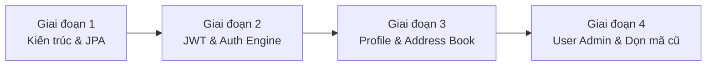

# KẾ HOẠCH TRIỂN KHAI PHÂN HỆ AUTHENTICATION, ACCESS CONTROL & PROFILE
> **Phân hệ:** Authentication, User Administration & Access Control, Profile Management  
> **Dự án:** SBA301 Badminton Shop (SE1986-JV)  
> **Kiến trúc tham chiếu:** `clonecuaco` (`talenthub_be` - Spring Boot 3/4, Spring Security, JJWT 0.12.x, Spring Data JPA)  
> **Trạng thái:** Kế hoạch thực thi chính thức (Implementation Plan)

---

## 1. MỤC TIÊU & NGUYÊN TẮC THỰC THI

1. **Xóa bỏ Anti-pattern:** Dọn sạch các file nén phẳng và thư mục rỗng trong `modules/auth`, loại bỏ hoàn toàn việc gọi `JdbcTemplate` viết SQL thô trực tiếp trong Controller/Service.
2. **Chuẩn hóa tầng dữ liệu (Data Access Layer):** Chuyển sang Spring Data JPA, sử dụng `@EntityGraph` để triệt tiêu lỗi $N+1$ query khi truy vấn quan hệ `User` - `Role`.
3. **Thay thế cơ chế Session RAM bằng Stateless JWT:** Loại bỏ `ConcurrentHashMap` lưu UUID tạm bợ trong bộ nhớ máy chủ; tích hợp JJWT (HMAC-SHA ký số) chuẩn theo phong cách `talenthub_be`.
4. **Loại bỏ lỗ hổng `X-User-Id`:** Bỏ cơ chế bọc `HttpServletRequestWrapper` ép đè header; xóa bỏ `defaultValue = "1"` ở các controller lân cận (Support Ticket, Shipment), chuyển toàn bộ sang lấy user từ `SecurityContext` / `@AuthenticationPrincipal`.
5. **Hoàn thiện tính năng còn thiếu:** Bổ sung API Đăng ký khách hàng (`Register`), Quản lý hồ sơ cá nhân (`Profile`), Đổi mật khẩu (`Change Password`) và Sổ địa chỉ giao hàng (`Addresses`).
6. **Đồng bộ hóa Routing (Zero `/v1/`):** Đồng bộ quy chuẩn routing dạng `/api/{resource}` (`/api/auth`, `/api/profile`, `/api/users`), thống nhất với toàn bộ hệ thống catalog, inventory, shipment, invoice.

---

## 2. LỘ TRÌNH TRIỂN KHAI CHI TIẾT (4 GIAI ĐOẠN)

### Giai đoạn 1: Chuẩn hóa kiến trúc phân tầng & JPA Entity (Đã hoàn thành)
* **Trạng thái:** ✅ **Đã hoàn thành 100%**
* **Nhiệm vụ trọng tâm:**
  1. **Tổ chức lại package `modules/auth`:**
     - `controller`, `dto/request`, `dto/response`, `entity`, `enums`, `exception`, `repository`, `security`, `service/impl`.
  2. **Khai báo JPA Entities:**
     - `User`: Ánh xạ bảng `users` (`id`, `email`, `password_hash`, `full_name`, `phone`, `gender`, `birth_date`, `avatar_url`, `status`, `last_login_at`).
     - `Role`: Ánh xạ bảng `roles` (`id`, `code`, `name`).
     - `Address`: Ánh xạ bảng `addresses` (`id`, `user_id`, `receiver_name`, `phone`, `province`, `district`, `ward`, `street`, `is_default`).
     - `UserStatus`: Enum `ACTIVE`, `INACTIVE`, `LOCKED`.
  3. **Xây dựng Spring Data Repositories:**
     - `UserRepository`: Bổ sung `@EntityGraph(attributePaths = {"roles"}) Optional<User> findByEmail(String email)` và `boolean existsByEmail(String email)`.
     - `RoleRepository`: `Optional<Role> findByCode(String code)`.
     - `AddressRepository`: `List<Address> findByUserIdOrderByIsDefaultDesc(Long userId)`.

---

### Giai đoạn 2: Động cơ JWT & Phân hệ Authentication (Đã hoàn thành)
* **Trạng thái:** ✅ **Đã hoàn thành 100%**
* **Nhiệm vụ trọng tâm:**
  1. **Thêm dependency JJWT vào `pom.xml`:** `jjwt-api`, `jjwt-impl`, `jjwt-jackson` (phiên bản `0.12.7`).
  2. **Xây dựng module `security`:**
     - `CustomUserDetails`: Implements `UserDetails`, chứa `id`, `email`, `fullName`, `authorities` (ROLE_ADMIN, ROLE_STAFF,...).
     - `UserDetailsServiceImpl`: Nạp thông tin user qua `UserRepository`, chuyển `Role` thành `SimpleGrantedAuthority`.
     - `JwtProperties`: Cấu hình secret-key, thời gian sống của token (TTL).
     - `JwtService`: Tạo Access Token (chứa claims: `userId`, `email`, `roles`), trích xuất claims, xác thực token hợp lệ.
     - `JwtAuthenticationFilter`: Filter `OncePerRequestFilter` trích xuất Bearer token từ header `Authorization`, xác thực và gán vào `SecurityContextHolder`.
  3. **Cập nhật `SecurityConfig`:**
     - Tích hợp `AuthenticationManager`, `DaoAuthenticationProvider`, `BCryptPasswordEncoder`.
     - Cấu hình phân quyền endpoint:
       - Public: `/api/auth/login`, `/api/auth/register`, `/api/shop/**`, `/api/catalog/**`.
       - Yêu cầu đăng nhập: `/api/auth/me`, `/api/auth/logout`, `/api/profile/**`.
       - Quyền Admin: `/api/users/**`.
     - Xử lý lỗi trả về JSON chuẩn qua `AuthenticationEntryPoint` (401) và `AccessDeniedHandler` (403).
  4. **Triển khai `AuthService` & `AuthController`:**
     - `POST /api/auth/register`: Đăng ký tài khoản khách hàng mới (mặc định role `CUSTOMER`, trạng thái `active`).
     - `POST /api/auth/login`: Xác thực credentials qua `AuthenticationManager`, trả về token và thông tin cơ bản.
     - `POST /api/auth/logout`: Xóa session context.
     - `GET /api/auth/me`: Trả về thông tin danh tính người dùng hiện tại từ context.
  5. **Tích hợp Frontend:** Nối form tại [`RegisterPage.jsx`](file:///d:/SBA301_BadmintonShop_SE1986-JV/frontend/src/modules/auth/pages/RegisterPage.jsx) vào API `register`.

---

### Giai đoạn 3: Phân hệ Profile Management & Sổ địa chỉ (Đã hoàn thành)
* **Trạng thái:** ✅ **DONE (100%)**
* **Thời lượng dự kiến:** 2 ngày.
* **Nhiệm vụ trọng tâm:**
  - [x] ✅ **Tạo `ProfileService` & `ProfileController` (`/api/profile`):**
     - `GET /api/profile`: Lấy đầy đủ thông tin cá nhân của user đang đăng nhập.
     - `PUT /api/profile`: Cập nhật họ tên, số điện thoại, ngày sinh, giới tính, avatar URL.
     - `POST /api/profile/change-password`: Kiểm tra mật khẩu hiện tại bằng `passwordEncoder.matches`, cập nhật mật khẩu mới nếu hợp lệ.
  - [x] ✅ **Quản lý sổ địa chỉ giao hàng (`/api/profile/addresses`):**
     - `GET /api/profile/addresses`: Lấy danh sách địa chỉ nhận hàng của user.
     - `POST /api/profile/addresses`: Thêm địa chỉ mới; nếu đánh dấu `is_default = true`, tự động hủy cờ mặc định của các địa chỉ cũ.
     - `PUT /api/profile/addresses/{id}`: Chỉnh sửa thông tin địa chỉ (chỉ được sửa địa chỉ của chính mình).
     - `DELETE /api/profile/addresses/{id}`: Xóa địa chỉ nhận hàng.
  - [x] ✅ **Tích hợp Giao diện Frontend (`ProfilePage.jsx`):**
     - Xây dựng trang hồ sơ cá nhân [`ProfilePage.jsx`](file:///d:/SBA301_BadmintonShop_SE1986-JV/frontend/src/modules/auth/pages/ProfilePage.jsx) gồm 3 tab chức năng: Thông tin tài khoản, Sổ địa chỉ (kèm modal Thêm/Sửa/Xóa địa chỉ), Đổi mật khẩu.
     - Tự đóng gói style trực tiếp trong JSX (`<style>` nội bộ), tương thích giao diện cửa hàng và không phụ thuộc file CSS rời.
     - Đăng ký route bảo vệ `/profile` trong [`public.routes.jsx`](file:///d:/SBA301_BadmintonShop_SE1986-JV/frontend/src/app/router/public.routes.jsx).
     - Thêm liên kết truy cập "Hồ sơ cá nhân" trên Header Dropdown ([`PublicHeader.jsx`](file:///d:/SBA301_BadmintonShop_SE1986-JV/frontend/src/app/layouts/public/PublicHeader.jsx)) và thanh điều hướng bên ([`PublicSidebar.jsx`](file:///d:/SBA301_BadmintonShop_SE1986-JV/frontend/src/app/layouts/public/PublicSidebar.jsx)).
     - Bổ sung `profileApi` trong [`auth.api.js`](file:///d:/SBA301_BadmintonShop_SE1986-JV/frontend/src/modules/auth/api/auth.api.js).
  - [x] ✅ **Bộ kiểm thử tự động (Unit & Integration Tests):**
     - `ProfileServiceTest`: 13/13 tests kiểm tra logic cập nhật profile, đổi mật khẩu, sổ địa chỉ và chuyển cờ mặc định.
     - `ProfileControllerTest`: 8/8 tests kiểm tra xác thực JWT, mã trạng thái HTTP (200, 201, 401, 404).

---

### Giai đoạn 4: User Administration & Dọn dẹp mã cũ (Ưu tiên 2 & 3)
> **Kế hoạch chi tiết tái cấu trúc Single-Role & Hoàn thiện Giai đoạn 4:** Xem [`single_role_refactor_plan.md`](./single_role_refactor_plan.md)
* **Thời lượng dự kiến:** 2 ngày.
* **Nhiệm vụ trọng tâm:**
  1. **Tái cấu trúc `UserController` & `UserService` (`/api/users`):**
     - `GET /api/users`: Phân trang danh sách người dùng (`Pageable`), hỗ trợ lọc theo từ khóa tìm kiếm (`keyword`) và vai trò (`role`).
     - `GET /api/users/{id}`: Xem chi tiết tài khoản.
     - `POST /api/users`: Admin tạo tài khoản nhân viên / quản lý, cấp quyền trực tiếp.
     - `PATCH /api/users/{id}`: Cập nhật thông tin, thay đổi vai trò hoặc thay đổi trạng thái (`active` / `locked`).
  2. **Khắc phục triệt để lỗ hổng `X-User-Id`:**
     - Xóa bỏ lớp bọc `HttpServletRequestWrapper` giả lập header trong `TokenFilter`.
     - Thay thế toàn bộ `@RequestHeader(value = "X-User-Id", defaultValue = "1")` tại `CustomerTicketController`, `StaffTicketController`, `CustomerShipmentController` sang `@AuthenticationPrincipal CustomUserDetails`.
  3. **Cập nhật Unit & Integration Tests:**
     - Cập nhật `AuthServiceTest` và `AuthSecurityTest` sang cấu hình MockMvc với JWT token thật thay cho mock chuỗi thô.

---

## 3. BẢNG TỔNG HỢP API & DATABASE MAPPING

| Phân hệ | Phương thức | Endpoint | Phân quyền | Bảng CSDL tác động | Trạng thái |
| :--- | :---: | :--- | :---: | :--- | :---: |
| **Auth** | `POST` | `/api/auth/register` | Public | `users`, `user_roles` | ✅ **DONE** |
| **Auth** | `POST` | `/api/auth/login` | Public | `users` (`last_login_at`) | ✅ **DONE** |
| **Auth** | `POST` | `/api/auth/logout` | Authenticated | Không | ✅ **DONE** |
| **Auth** | `GET` | `/api/auth/me` | Authenticated | `users`, `user_roles`, `roles` | ✅ **DONE** |
| **Profile** | `GET` | `/api/profile` | Authenticated | `users` | ✅ **DONE** |
| **Profile** | `PUT` | `/api/profile` | Authenticated | `users` | ✅ **DONE** |
| **Profile** | `POST` | `/api/profile/change-password` | Authenticated | `users` (`password_hash`) | ✅ **DONE** |
| **Profile** | `GET` | `/api/profile/addresses` | Authenticated | `addresses` | ✅ **DONE** |
| **Profile** | `POST` | `/api/profile/addresses` | Authenticated | `addresses` | ✅ **DONE** |
| **Profile** | `PUT` | `/api/profile/addresses/{id}` | Authenticated | `addresses` | ✅ **DONE** |
| **Profile** | `DELETE` | `/api/profile/addresses/{id}` | Authenticated | `addresses` | ✅ **DONE** |
| **User Admin** | `GET` | `/api/users` | `ROLE_ADMIN` | `users`, `user_roles`, `roles` | ⏳ *Chưa làm* |
| **User Admin** | `GET` | `/api/users/{id}` | `ROLE_ADMIN` | `users`, `user_roles`, `roles` | ⏳ *Chưa làm* |
| **User Admin** | `POST` | `/api/users` | `ROLE_ADMIN` | `users`, `user_roles` | ⏳ *Chưa làm* |
| **User Admin** | `PATCH` | `/api/users/{id}` | `ROLE_ADMIN` | `users`, `user_roles` | ⏳ *Chưa làm* |

---

## 4. TIÊU CHÍ NGHIỆM THU (DEFINITION OF DONE)

- [ ] 🔄 **1. Kiến trúc:** Module `auth` cốt lõi và `profile` đã chuyển đổi 100% sang Controller $\rightarrow$ Service $\rightarrow$ Repository $\rightarrow$ Entity (JPA). Còn lại `UserController` cũ đang dùng `JdbcTemplate` (sẽ hoàn tất ở Giai đoạn 4).
- [ ] 🔄 **2. Bảo mật:** Đăng nhập sinh token JWT hợp lệ chuẩn JJWT; tắt/bật lại server không làm mất session của token còn hạn. Tạm thời bọc tương thích `X-User-Id`, chưa refactor dứt điểm ở các controller ticket/shipment (sẽ xử lý ở Giai đoạn 4).
- [x] ✅ **3. Chức năng (DONE):** Khách hàng đăng ký được tài khoản từ giao diện React, đăng nhập nhận token, xem và cập nhật thông tin cá nhân, đổi mật khẩu và quản lý danh sách địa chỉ nhận hàng ngay trên trang `ProfilePage.jsx`.
- [x] ✅ **4. Kiểm thử (DONE):** Toàn bộ test suite backend (`mvn test`) vượt qua màu xanh với 131/131 tests (`BUILD SUCCESS`), trong đó gồm 21 unit & integration tests chuyên sâu cho Profile. Frontend build (`npm run build`) hoàn tất sạch lỗi.
