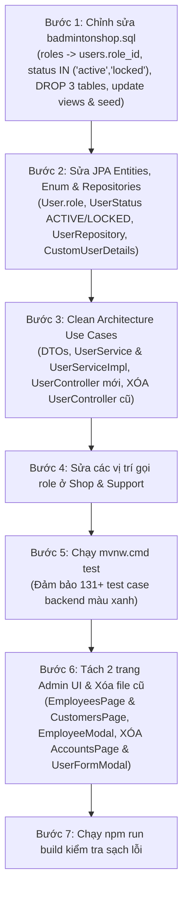

# KẾ HOẠCH TÁI CẤU TRÚC PHÂN QUYỀN SANG MÔ HÌNH 1 USER - 1 ROLE VÀ TRIỂN KHAI HOÀN THIỆN USER ADMINISTRATION (GIAI ĐOẠN 4)
> **Dự án:** SBA301 Badminton Shop (SE1986-JV)  
> **Phân hệ:** Authentication, Access Control & User Administration  
> **Mục tiêu:** Chuyển đổi toàn diện từ mô hình nhiều vai trò ($N-N$) sang mô hình **1 User có đúng 1 Role duy nhất ($1-N$)**, triệt tiêu toàn bộ mã gọi `roles` dạng danh sách (list) ở cả Backend & Frontend, chuẩn hóa trạng thái tài khoản thành **2 trạng thái duy nhất (`active`, `locked`)**, áp dụng **Clean Architecture**, xóa bỏ toàn bộ mã/bảng rác thừa và hoàn thiện Giai đoạn 4 với 2 trang chuyên biệt: `/admin/employees` & `/admin/customers`.  
> **Nguyên tắc kỹ thuật cốt lõi:**  
> 1. **FAIL-FAST (Zero Silent Fallbacks):** Nghiêm cấm gán mặc định hay lờ đi dữ liệu role thiếu sót ở mọi tầng.  
> 2. **CHUẨN HÓA 2 TRẠNG THÁI (`ACTIVE` & `LOCKED`):** Xóa bỏ trạng thái `inactive` gây nhập nhằng ngữ nghĩa. Chỉ giữ `active` (hoạt động) và `locked` (đã khóa).  
> 3. **SELF-ACCOUNT PROTECTION (Chống Lockout):** Admin không được phép tự khóa tài khoản (`locked`) hoặc tự đổi vai trò của chính tài khoản đang đăng nhập.  
> 4. **CLEAN ARCHITECTURE & DỌN DẸP MÃ THỪA:** Xóa sạch file cũ/raw SQL; tách biệt 4 tầng: Controller/DTOs $\rightarrow$ Service Use Cases $\rightarrow$ Domain Entities $\rightarrow$ JPA Repositories.  
> 5. **SEPARATION OF CONCERNS (Tách biệt màn hình quản lý):** Tách giao diện Quản lý Nhân sự (`/admin/employees`) và Quản lý Khách hàng (`/admin/customers`).

---

## 1. TỔNG QUAN & BẢN CHẤT KIẾN TRÚC MỚI

### 1.1. So sánh kiến trúc
| Thành phần | Kiến trúc cũ (Multi-roles & 3 Status) | Kiến trúc mới (Single-role & 2 Status & Clean Arch) | Lợi ích |
| :--- | :--- | :--- | :--- |
| **Database Schema** | Bảng `users`, `roles`, bảng trung gian `user_roles`, `permissions`, `role_permissions`. Status: `active`, `inactive`, `locked`. | Bảng `roles` (tạo trước), bảng `users` chứa `role_id INT NOT NULL` tham chiếu `roles(id)`. Status: `CHECK (status IN ('active', 'locked'))`. | Xóa bỏ 3 bảng dư thừa, chuẩn hóa quan hệ $1-N$, loại bỏ trạng thái `inactive` dư thừa. |
| **JPA Entity** | `@ManyToMany Set<Role> roles`, enum 3 giá trị | `@ManyToOne Role role`, enum `UserStatus` chỉ gồm `ACTIVE`, `LOCKED` | Triệt tiêu lỗi $N+1$ query, code rõ nghĩa, không nhầm lẫn giữa inactive và locked. |
| **Security Principal** | `authorities` chứa mảng roles, `isAccountNonLocked()` map tạm bợ | `CustomUserDetails` lưu 1 role; `isAccountNonLocked() = !isLocked()`, `isEnabled() = isActive()` | Chuẩn hóa hoàn hảo theo Spring Security specification. |
| **Kiến trúc Code BE** | Raw SQL trong `UserController`, `new BCryptPasswordEncoder()` tùy tiện | Clean Architecture chuẩn (DTOs $\rightarrow$ Service Interface $\rightarrow$ Service Impl $\rightarrow$ JPA Repository $\rightarrow$ Entity) | Code tường minh, dễ viết unit test, độc lập với cơ chế persistence. |
| **Bảo vệ tài khoản Admin** | Không kiểm tra, Admin có thể tự lock chính mình | Bắt buộc kiểm tra `targetUserId == currentUserId`, cấm tự đổi role và cấm tự đổi status sang `LOCKED` | Ngăn chặn hoàn toàn sự cố Admin Lockout. |
| **Giao diện Quản lý (FE)** | 1 màn hình chung `AccountsPage`, trộn lẫn khách hàng và nhân sự | Tách 2 trang: **Nhân viên & Quản lý** (`/admin/employees`) và **Khách hàng** (`/admin/customers`) | UX rõ ràng; không để lộ ô nhập mật khẩu đối với khách hàng; bảo mật thông tin khách. |

### 1.2. Nguyên tắc Bắt lỗi lập tức (Fail-Fast Principle - Zero Silent Fallbacks)
1. **Triệt tiêu Silent Fallback:** Không bao giờ viết code kiểu `user.getRole() != null ? user.getRole().getCode() : "CUSTOMER"`. Nếu một user trong DB bị thiếu role, hoặc câu truy vấn quên nạp role, hệ thống phải **ném ngay `IllegalStateException`** kèm ID của user thay vì âm thầm giáng cấp họ về `CUSTOMER`.
2. **Database là Nguồn Chân lý (Source of Truth):** Không dùng `roleRepository.findByCode(...).orElseGet(() -> roleRepository.save(...))`. DB phải có đủ seed data chuẩn. Nếu thiếu role, server phải dừng ngay và báo lỗi thiếu dữ liệu cấu hình.
3. **Frontend minh bạch quyền:** Nếu session không có `role`, coi như session không hợp lệ (`null`), buộc người dùng đăng nhập lại thay vì tự gán quyền mặc định che giấu lỗi token.

### 1.3. Nguyên tắc Bảo vệ Tài khoản Tự thân (Self-Account Protection)
- Trong use case `updateUser`:
  - `if (targetUserId.equals(currentUserId))`
    - Cố tình thay đổi `role` $\rightarrow$ Ném lỗi `400 Bad Request: "Không thể tự thay đổi vai trò của chính tài khoản đang đăng nhập."`
    - Cố tình thay đổi `status` thành `LOCKED` $\rightarrow$ Ném lỗi `400 Bad Request: "Không thể tự khóa tài khoản của chính mình."`
- Trên giao diện Frontend:
  - Khi render tài khoản của chính Admin đang login (`u.id === currentAdmin.id`), hiển thị huy hiệu `(Bạn)`, đồng thời vô hiệu hóa (disable) thao tác khóa tài khoản và dropdown thay đổi vai trò.

---

## 2. DANH MỤC CÁC TẬP TIN & DỮ LIỆU CẦN XÓA BỎ (OBSOLETE & DEAD CODE CLEANUP)

Nhằm đảm bảo dự án sạch 100%, không để sót mã rác (dead code), các thành phần sau sẽ được **xóa bỏ hoàn toàn**:

| STT | Thành phần | Vị trí / Tên | Hành động | Lý do xóa |
| :---: | :--- | :--- | :---: | :--- |
| 1 | **Database Table** | `user_roles` | XÓA | Thay thế bằng cột `role_id` trong `users`. |
| 2 | **Database Table** | `permissions` | XÓA | Hệ thống chỉ phân quyền theo Role, không dùng Permission. |
| 3 | **Database Table** | `role_permissions` | XÓA | Dư thừa theo bảng `permissions`. |
| 4 | **Database Seed** | `INSERT INTO permissions...`, `INSERT INTO role_permissions...`, `INSERT INTO user_roles...` | XÓA | Đồng bộ với việc xóa 3 bảng trên. |
| 5 | **Backend Legacy Controller** | `modules/auth/UserController.java` (nằm ở gốc `modules/auth/`) | XÓA | Chứa raw SQL JDBC, chuyển sang `modules/auth/controller/UserController.java` chuẩn Clean Architecture. |
| 6 | **Backend Enum Value** | Giá trị `INACTIVE("inactive")` trong `UserStatus.java` | XÓA | Chuẩn hóa hệ thống chỉ dùng 2 trạng thái `ACTIVE` và `LOCKED`. |
| 7 | **Frontend Legacy Page** | `modules/admin/pages/AccountsPage.jsx` | XÓA | Đã thay thế bằng 2 trang tách biệt `EmployeesPage.jsx` và `CustomersPage.jsx`. |
| 8 | **Frontend Legacy Modal** | `modules/admin/components/UserFormModal.jsx` | XÓA | Đã thay thế bằng `EmployeeModal.jsx` chuẩn single-role. |

---

## 3. DANH MỤC CHI TIẾT CÁC TẬP TIN & VỊ TRÍ CẦN SỬA ĐỔI / TẠO MỚI

```mermaid
flowchart LR
    subgraph DB ["1. Database"]
        F_DB["badmintonshop.sql\n(roles -> users.role_id, status IN ('active','locked'), drop 3 tables, update views & seed)"]
    end
    subgraph BE ["2. Backend Java (Clean Architecture)"]
        F_ENT["User.java\nRole.java\nUserStatus.java"]
        F_REPO["UserRepository.java\nRoleRepository.java"]
        F_SEC["CustomUserDetails.java\nUserDetailsServiceImpl.java\nJwtService.java"]
        F_DTO["AuthResponse.java\nUserResponse.java\nProfileResponse.java\nCreateEmployeeRequest.java\nUpdateUserRequest.java"]
        F_SRV["AuthService.java & Impl\nProfileServiceImpl.java\nUserService.java & UserServiceImpl"]
        F_CTRL["AuthController.java\nProfileController.java\nUserController.java (Mới trong package controller)"]
        F_SHOP["ShopController.java\nShopService.java\nSupportActions.java"]
        F_TEST["AuthServiceTest.java\nProfileServiceTest.java\nAuthSecurityTest.java\nUserServiceTest.java\nUserControllerTest.java"]
    end
    subgraph FE ["3. Frontend React (Tách 2 Trang)"]
        F_FESEC["session.js\nrolePaths.js\nProtectedRoute.jsx"]
        F_FELAY["AdminSidebar.jsx\nPublicHeader.jsx\nLoginPage.jsx\nadmin.routes.jsx"]
        F_FEADM["EmployeesPage.jsx\nCustomersPage.jsx\nEmployeeModal.jsx"]
        F_FESUP["SupportTicketManagementPage.jsx"]
    end

    DB --> BE --> FE
```



---

## 4. CHI TIẾT SỬA ĐỔI TỪNG FILE

### 4.1. Database (`badmintonshop.sql`)
- **Tập tin:** `d:\SBA301_BadmintonShop_SE1986-JV\badmintonshop.sql`
- **Nội dung thay đổi:**
  1. **Đổi thứ tự tạo bảng:** Định nghĩa bảng `roles` trước bảng `users`.
  2. **Bảng `users`:**
     - Thêm cột `role_id INT NOT NULL`, tạo khóa ngoại `FOREIGN KEY (role_id) REFERENCES roles(id)` và index `idx_users_role_id`.
     - Cập nhật ràng buộc check trạng thái: chỉ còn 2 giá trị:
       ```sql
       status VARCHAR(20) NOT NULL DEFAULT 'active' CHECK (status IN ('active', 'locked')),
       ```
  3. **Xóa bỏ 3 bảng:** Xóa định nghĩa `CREATE TABLE permissions`, `CREATE TABLE role_permissions`, `CREATE TABLE user_roles`.
  4. **Cập nhật 3 Views:**
     - `v_staff_performance`: Thay `JOIN user_roles ur ... JOIN roles r` bằng `JOIN roles r ON r.id = u.role_id`.
     - `v_customer_growth`: Thay `JOIN user_roles ur ... JOIN roles r` bằng `JOIN roles r ON r.id = u.role_id`.
     - `v_customer_summary`: Thay `JOIN user_roles ur ... JOIN roles r` bằng `JOIN roles r ON r.id = u.role_id`.
  5. **Cập nhật Seed Data:**
     - Giữ `INSERT INTO roles (code, name)`.
     - Xóa các câu lệnh `INSERT INTO permissions` và `INSERT INTO role_permissions`.
     - Cập nhật `INSERT INTO users (role_id, email, password_hash, full_name, status, email_verified_at)` gắn role_id tương ứng qua subquery `(SELECT id FROM roles WHERE code = '...')`.
     - Xóa câu lệnh `INSERT INTO user_roles`.

---

### 4.2. Backend: JPA Entity, Enum & Repository

#### File: `fu/se/badmintonshop/modules/auth/enums/UserStatus.java`
- **Xóa bỏ `INACTIVE`**, chỉ còn:
  ```java
  public enum UserStatus {
      ACTIVE("active"),
      LOCKED("locked");

      private final String value;

      UserStatus(String value) {
          this.value = value;
      }

      public String getValue() {
          return value;
      }

      public static UserStatus fromString(String text) {
          for (UserStatus b : UserStatus.values()) {
              if (b.value.equalsIgnoreCase(text)) {
                  return b;
              }
          }
          throw new IllegalArgumentException("Unknown user status: " + text);
      }
  }
  ```

#### File: `fu/se/badmintonshop/modules/auth/entity/User.java`
- **Vị trí sửa:** Dòng 53, 67–90.
- **Trước:** `@ManyToMany Set<Role> roles = new HashSet<>();`
- **Sau (Fail-Fast & Single-role & 2 Status):**
  ```java
  @Column(name = "status", nullable = false, length = 20)
  @Builder.Default
  private String status = "active";

  @ManyToOne(fetch = FetchType.LAZY, optional = false)
  @JoinColumn(name = "role_id", nullable = false)
  private Role role;

  public String getRoleCode() {
      if (this.role == null) {
          throw new IllegalStateException("User ID " + this.id + " has no role assigned");
      }
      return this.role.getCode();
  }

  public boolean isActive() {
      return "active".equalsIgnoreCase(status);
  }

  public boolean isLocked() {
      return "locked".equalsIgnoreCase(status);
  }

  public UserStatus getStatusEnum() {
      return UserStatus.fromString(status);
  }

  public void setStatusEnum(UserStatus userStatus) {
      if (userStatus == null) {
          throw new IllegalArgumentException("UserStatus cannot be null");
      }
      this.status = userStatus.getValue();
  }
  ```

#### File: `fu/se/badmintonshop/modules/auth/repository/UserRepository.java`
- **Vị trí sửa:** Dòng 17, 20, 28–38.
- **Sau:**
  ```java
  @EntityGraph(attributePaths = {"role"})
  Optional<User> findByEmailIgnoreCase(String email);

  @EntityGraph(attributePaths = {"role"})
  @Query("SELECT u FROM User u WHERE u.id = :id")
  Optional<User> findWithRoleById(@Param("id") Long id);

  @Query(value = "SELECT u FROM User u JOIN FETCH u.role r " +
                 "WHERE (:keyword IS NULL OR LOWER(u.email) LIKE LOWER(CONCAT('%', :keyword, '%')) " +
                 "OR LOWER(u.fullName) LIKE LOWER(CONCAT('%', :keyword, '%')) " +
                 "OR LOWER(u.phone) LIKE LOWER(CONCAT('%', :keyword, '%'))) " +
                 "AND (:roleCode IS NULL OR LOWER(r.code) = LOWER(:roleCode))",
         countQuery = "SELECT COUNT(u) FROM User u JOIN u.role r " +
                      "WHERE (:keyword IS NULL OR LOWER(u.email) LIKE LOWER(CONCAT('%', :keyword, '%')) " +
                      "OR LOWER(u.fullName) LIKE LOWER(CONCAT('%', :keyword, '%')) " +
                      "OR LOWER(u.phone) LIKE LOWER(CONCAT('%', :keyword, '%'))) " +
                      "AND (:roleCode IS NULL OR LOWER(r.code) = LOWER(:roleCode))")
  Page<User> searchUsers(@Param("keyword") String keyword, @Param("roleCode") String roleCode, Pageable pageable);
  ```

---

### 4.3. Backend: Security & JWT (Fail-Fast, Zero Silent Fallbacks)

#### File: `fu/se/badmintonshop/modules/auth/security/CustomUserDetails.java`
- **Cải tiến Fail-Fast & Map chuẩn Spring Security:**
  ```java
  private final Long id;
  private final String email;
  private final String fullName;
  private final String password;
  private final boolean active;
  private final boolean locked;
  private final String role;
  private final Collection<? extends GrantedAuthority> authorities;

  public CustomUserDetails(Long id, String email, String fullName, String password, boolean active, boolean locked, String role) {
      if (role == null || role.isBlank()) {
          throw new IllegalArgumentException("User role must not be null or blank");
      }
      this.id = id;
      this.email = email;
      this.fullName = fullName;
      this.password = password;
      this.active = active;
      this.locked = locked;
      this.role = role.trim().toUpperCase(Locale.ROOT);
      this.authorities = List.of(new SimpleGrantedAuthority("ROLE_" + this.role));
  }

  public String role() {
      return role;
  }

  public String getRole() {
      return role;
  }

  @Override
  public boolean isAccountNonLocked() {
      return !locked;
  }

  @Override
  public boolean isEnabled() {
      return active;
  }
  ```

#### File: `fu/se/badmintonshop/modules/auth/service/impl/UserDetailsServiceImpl.java`
- **Cải tiến Fail-Fast:**
  ```java
  @Override
  @Transactional(readOnly = true)
  public UserDetails loadUserByUsername(String username) throws UsernameNotFoundException {
      if (username == null || username.isBlank()) {
          throw new UsernameNotFoundException("Email cannot be blank");
      }

      User user = userRepository.findByEmailIgnoreCase(username.trim())
          .orElseThrow(() -> new UsernameNotFoundException("User not found with email: " + username));

      if (user.getRole() == null || user.getRole().getCode() == null || user.getRole().getCode().isBlank()) {
          throw new IllegalStateException("User ID " + user.getId() + " (" + user.getEmail() + ") has no role assigned in database");
      }

      String roleCode = user.getRole().getCode().trim();
      return new CustomUserDetails(
          user.getId(),
          user.getEmail(),
          user.getFullName(),
          user.getPasswordHash(),
          user.isActive(),
          user.isLocked(),
          roleCode
      );
  }
  ```

#### File: `fu/se/badmintonshop/modules/auth/security/JwtService.java`
- **Cải tiến Fail-Fast:**
  ```java
  public String generateAccessToken(CustomUserDetails userDetails) {
      String role = userDetails.role();
      if (role == null || role.isBlank()) {
          throw new IllegalStateException("Cannot generate token: user details has no role");
      }

      Instant now = Instant.now();
      return Jwts.builder()
          .id(UUID.randomUUID().toString())
          .subject(userDetails.getUsername())
          .claim("userId", userDetails.getId())
          .claim("fullName", userDetails.getFullName())
          .claim("role", role)
          .issuedAt(Date.from(now))
          .expiration(Date.from(now.plusSeconds(properties.accessTokenTtlSeconds())))
          .signWith(getSigningKey())
          .compact();
  }
  ```

---

### 4.4. Backend: Clean Architecture cho Giai đoạn 4 (User Administration)

#### 1. Xóa bỏ File cũ:
- **Xóa file:** `d:\SBA301_BadmintonShop_SE1986-JV\backend\badmintonshop\src\main\java\fu\se\badmintonshop\modules\auth\UserController.java`.

#### 2. Tầng DTOs:
- Tạo mới `CreateEmployeeRequest.java` tại `fu.se.badmintonshop.modules.auth.dto.request`:
  ```java
  public record CreateEmployeeRequest(
      @NotBlank(message = "Email không được để trống") @Email(message = "Email không đúng định dạng") String email,
      @NotBlank(message = "Họ tên không được để trống") String fullName,
      @NotBlank(message = "Mật khẩu không được để trống") @Size(min = 6, message = "Mật khẩu tối thiểu 6 ký tự") String password,
      String phone,
      String gender,
      @NotBlank(message = "Vai trò không được để trống") String role // Chỉ nhận: ADMIN, MANAGER, STAFF
  ) {}
  ```
- Tạo mới `UpdateUserRequest.java` tại `fu.se.badmintonshop.modules.auth.dto.request`:
  ```java
  public record UpdateUserRequest(
      String fullName,
      String phone,
      String gender,
      String role,   // Đổi vai trò (chỉ nội bộ)
      String status, // ACTIVE, LOCKED
      String password // Reset mật khẩu nếu có
  ) {}
  ```
- Cập nhật `UserResponse.java` tại `fu.se.badmintonshop.modules.auth.dto.response`:
  ```java
  @Getter @Setter @NoArgsConstructor @AllArgsConstructor @Builder
  public class UserResponse {
      private Long id;
      private String email;
      private String fullName;
      private String phone;
      private String gender;
      private LocalDate birthDate;
      private String avatarUrl;
      private String status; // "active" hoặc "locked"
      private boolean active;
      private boolean locked;
      private String role; // String 1 role duy nhất
      private LocalDateTime lastLoginAt;
      private LocalDateTime createdAt;
  }
  ```

#### 3. Tầng Use Case Service (`UserService` & `UserServiceImpl`):
- Tạo interface `UserService.java` tại `fu.se.badmintonshop.modules.auth.service`:
  ```java
  public interface UserService {
      Page<UserResponse> listUsers(String keyword, String roleCode, Pageable pageable);
      UserResponse getUser(Long id);
      UserResponse createEmployee(CreateEmployeeRequest request);
      UserResponse updateUser(Long id, UpdateUserRequest request, Long currentUserId);
  }
  ```
- Tạo class `UserServiceImpl.java` tại `fu.se.badmintonshop.modules.auth.service.impl`:
  1. **Tạo tài khoản nhân sự (`createEmployee`):**
     - Role bắt buộc thuộc `ADMIN`, `MANAGER`, `STAFF` (chặn không cho tạo `CUSTOMER` qua cổng này).
     - Kiểm tra trùng email qua `userRepository.existsByEmailIgnoreCase`.
     - Mã hóa mật khẩu bằng `PasswordEncoder` bean inject từ Spring Context.
     - Lưu User với trạng thái `active`.
  2. **Cập nhật tài khoản (`updateUser`):**
     - **Tự bảo vệ tài khoản (Self-Account Protection):**
       ```java
       if (id.equals(currentUserId)) {
           if (request.role() != null && !request.role().equalsIgnoreCase(targetUser.getRole().getCode())) {
               throw new ResponseStatusException(HttpStatus.BAD_REQUEST, "Không thể tự thay đổi vai trò của chính tài khoản đang đăng nhập.");
           }
           if (request.status() != null && "locked".equalsIgnoreCase(request.status())) {
               throw new ResponseStatusException(HttpStatus.BAD_REQUEST, "Không thể tự khóa tài khoản của chính mình.");
           }
       }
       ```
     - Cập nhật status: Chỉ chấp nhận `"active"` hoặc `"locked"`.
     - Cập nhật thông tin họ tên, phone, gender, role (nếu role hợp lệ), reset password (nếu có).

#### 4. Tầng Presentation Controller (`UserController.java` chuẩn Clean Architecture):
- Tạo class mới `UserController.java` tại package chuẩn `fu.se.badmintonshop.modules.auth.controller`:
  ```java
  package fu.se.badmintonshop.modules.auth.controller;

  @RestController
  @RequestMapping("/api/users")
  @RequiredArgsConstructor
  @PreAuthorize("hasRole('ADMIN')")
  public class UserController {

      private final UserService userService;

      @GetMapping
      public ResponseEntity<Page<UserResponse>> list(
          @RequestParam(required = false) String keyword,
          @RequestParam(required = false) String role,
          @PageableDefault(size = 10, sort = "id", direction = Sort.Direction.DESC) Pageable pageable
      ) {
          return ResponseEntity.ok(userService.listUsers(keyword, role, pageable));
      }

      @GetMapping("/{id}")
      public ResponseEntity<UserResponse> get(@PathVariable Long id) {
          return ResponseEntity.ok(userService.getUser(id));
      }

      @PostMapping
      public ResponseEntity<UserResponse> createEmployee(@Valid @RequestBody CreateEmployeeRequest request) {
          return ResponseEntity.status(HttpStatus.CREATED).body(userService.createEmployee(request));
      }

      @PatchMapping("/{id}")
      public ResponseEntity<UserResponse> update(
          @PathVariable Long id,
          @RequestBody UpdateUserRequest request,
          @AuthenticationPrincipal CustomUserDetails currentUser
      ) {
          return ResponseEntity.ok(userService.updateUser(id, request, currentUser.getId()));
      }
  }
  ```

---

### 4.5. Backend: Sửa các vị trí gọi role ở Module lân cận & Test Suite

#### File: `fu/se/badmintonshop/modules/shop/ShopController.java`
- Dòng 41: `return new AuthService.User(cud.getId(), cud.getEmail(), cud.getFullName(), cud.role(), cud.isActive());`

#### File: `fu/se/badmintonshop/modules/shop/ShopService.java`
- Dòng 327: `user != null && Set.of("STAFF", "MANAGER", "ADMIN").contains(user.role())`

#### File: `fu/se/badmintonshop/modules/shop/SupportActions.java`
- Dòng 30 & 70: `user != null && Set.of("MANAGER", "ADMIN").contains(user.role())`

#### Cập nhật Test Suite:
1. `AuthSecurityTest.java`: Cập nhật khởi tạo `CustomUserDetails(..., active, locked, role)`.
2. `AuthServiceTest.java`: Cập nhật fixtures gán `user.setRole(role)` và assert `res.getRole()`.
3. `ProfileServiceTest.java`: Cập nhật `user.setRole(role)`.
4. `ProfileControllerTest.java`: Cập nhật mock `ProfileResponse` với `.role("CUSTOMER")`.
5. Tạo mới `UserServiceTest.java` và `UserControllerTest.java`: Kiểm thử nghiệp vụ quản lý tài khoản, chống self-lockout, phân trang và validation.

---

### 4.6. Frontend: Tách biệt 2 Trang Quản Lý (`/admin/employees` vs `/admin/customers`)

#### 1. Xóa bỏ File cũ:
- **Xóa file:** `frontend/src/modules/admin/pages/AccountsPage.jsx`.
- **Xóa file:** `frontend/src/modules/admin/components/UserFormModal.jsx`.

#### 2. Tạo mới `EmployeesPage.jsx` & `EmployeeModal.jsx`:
- **Đường dẫn:** `frontend/src/modules/admin/pages/EmployeesPage.jsx`.
- **Đường dẫn modal:** `frontend/src/modules/admin/components/EmployeeModal.jsx`.
- **Tính năng:**
  - Nút `+ Thêm nhân sự`: Mở modal nhập Email, Họ tên, Chọn vai trò (`STAFF`, `MANAGER`, `ADMIN`), Mật khẩu ban đầu.
  - Bộ lọc: Lọc theo vai trò (Tất cả, Admin, Manager, Staff) và trạng thái (Tất cả, Hoạt động, Đã khóa).
  - Bảng danh sách: ID, Email, Họ tên, Vai trò (Badge màu sắc), Trạng thái (🟢 Hoạt động / 🔴 Đã khóa), Lần đăng nhập cuối.
  - **Self-Account Protection:** Nếu dòng hiển thị chính Admin đang đăng nhập:
    - Hiển thị badge `(Bạn)` cạnh họ tên.
    - Vô hiệu hóa nút Khóa tài khoản.
    - Trong modal Sửa: Disable dropdown đổi Role và toggle Status.

#### 3. Tạo mới `CustomersPage.jsx`:
- **Đường dẫn:** `frontend/src/modules/admin/pages/CustomersPage.jsx`.
- **Tính năng:**
  - **Không có nút tạo tài khoản, không hiển thị/chỉnh sửa mật khẩu.**
  - Bộ lọc: Tìm kiếm theo họ tên/email/phone, lọc trạng thái (`ACTIVE`, `LOCKED`).
  - Bảng danh sách: ID, Họ tên, Email, Số điện thoại, Ngày đăng ký, Trạng thái tài khoản (🟢 Hoạt động / 🔴 Đã khóa).
  - Thao tác: Nút chuyển đổi nhanh **Khóa tài khoản (`locked`)** / **Mở khóa (`active`)** với hộp thoại xác nhận.

#### 4. Định tuyến & Sidebar (`admin.routes.jsx` & `AdminSidebar.jsx`):
- `admin.routes.jsx`:
  ```jsx
  {
    path: '/admin',
    element: <AdminLayout />,
    children: [
      { index: true, element: <Navigate to="/admin/employees" replace /> },
      { path: 'employees', element: <EmployeesPage /> },
      { path: 'customers', element: <CustomersPage /> },
    ],
  }
  ```
- `AdminSidebar.jsx`:
  ```jsx
  <NavLink to="/admin/employees" className="admin-nav-link">
    <span className="admin-nav-icon">👔</span>
    <span>Nhân viên</span>
  </NavLink>
  <NavLink to="/admin/customers" className="admin-nav-link">
    <span className="admin-nav-icon">👥</span>
    <span>Khách hàng</span>
  </NavLink>
  ```
- `rolePaths.js`:
  ```javascript
  export const ROLE_HOME_PATHS = {
    ADMIN: '/admin/employees',
    MANAGER: '/management',
    STAFF: '/management',
    CUSTOMER: '/',
  };
  ```

---

## 5. LỘ TRÌNH THỰC THI & KIỂM CHỨNG TỪNG BƯỚC


