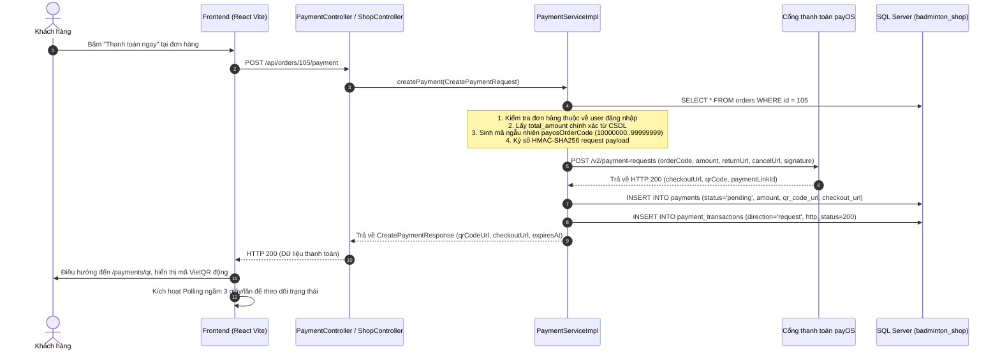
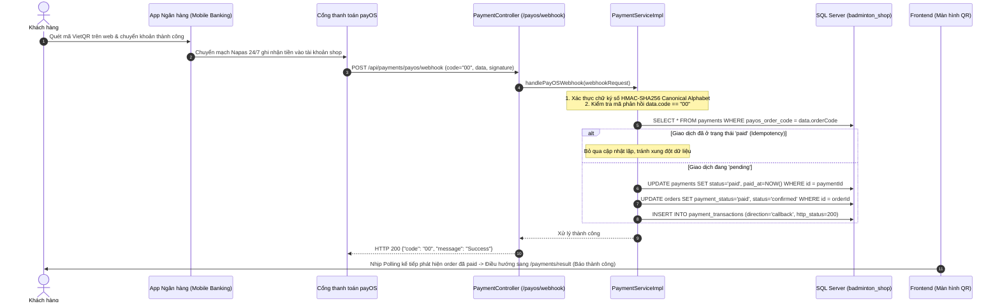
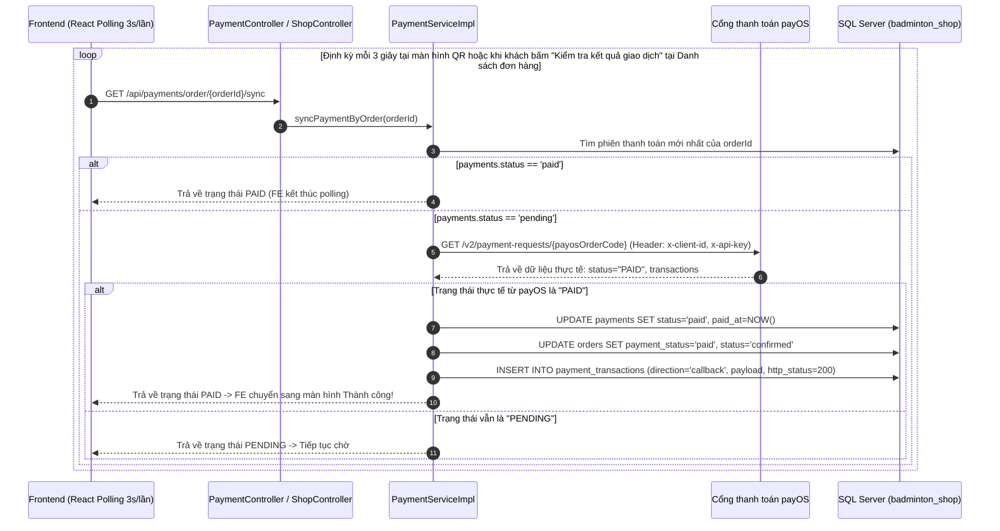
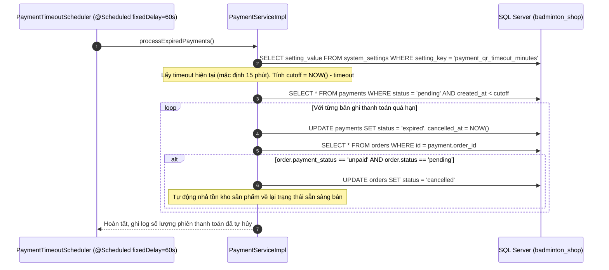
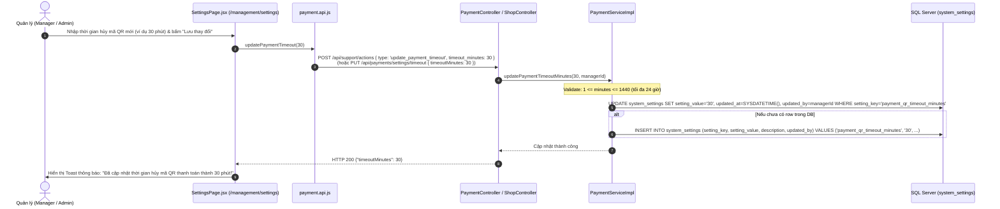
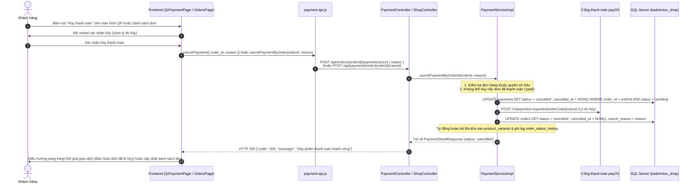

# TÀI LIỆU TOÀN DIỆN MODULE THANH TOÁN (PAYMENT MODULE SPECIFICATION)

> **Dự án:** Badminton Shop Management System (SBA301_BadmintonShop_SE1986-JV)  
> **Cổng thanh toán:** payOS (VietQR Napas 24/7 Chuẩn Quốc Gia)  
> **Kiến trúc:** RESTful Zero `/v1/` (`/api/payments`) & Unified Shop Actions (`/api/support/actions`)
> **Ngày cập nhật:** 08/11/2026

---

## 1. TOÀN BỘ CÔNG NGHỆ ÁP DỤNG (TECHNOLOGY STACK)

### 1.1. Backend Framework & Ngôn ngữ

- **Java 21 LTS:** Tận dụng Virtual Threads, Pattern Matching và tính ổn định cao.
- **Spring Boot 3.3.x:** Nền tảng framework chính cho Dependency Injection và micro-module architecture.
- **Spring Data JPA & Hibernate:** ORM quản trị quan hệ dữ liệu cho các thực thể `Payment`, `PaymentTransaction`, `Order`.
- **Spring JDBC (`JdbcTemplate`):** Truy vấn và quản lý bảng cấu hình động `system_settings` không cần phụ thuộc entity mapping phức tạp.
- **Spring Task Scheduling (`@EnableScheduling`, `@Scheduled`):** Vận hành `PaymentTimeoutScheduler` chạy nền định kỳ mỗi 60 giây để xử lý hết hạn phiên thanh toán.
- **Spring Security 6:** Cơ chế Stateless Authentication qua JWT Bearer Token, kiểm soát truy cập phân quyền chặt chẽ theo vai trò (`CUSTOMER`, `STAFF`, `MANAGER`, `ADMIN`).
- **Lombok & Jakarta Validation:** Giảm boilerplate code và chuẩn hóa dữ liệu đầu vào (`@NotNull`, `@Min`, `@NotBlank`).
- **Jackson FasterXML:** Xử lý serialization/deserialization JSON với cấu hình `PropertyNamingStrategies.SNAKE_CASE`.

### 1.2. Cổng thanh toán & Tích hợp Mạng (Payment Gateway Integration)

- **Cổng thanh toán payOS (VietQR Napas 24/7):** Tạo link thanh toán động, sinh mã QR VietQR chuẩn ngân hàng thanh toán tức thì 24/7.
- **Thuật toán chữ ký số HMAC-SHA256:**
  - Ký số bảo vệ toàn vẹn dữ liệu khi gửi request tạo thanh toán sang payOS.
  - Sắp xếp canonical alphabetical các thuộc tính: `amount`, `cancelUrl`, `description`, `orderCode`, `returnUrl`.
  - Xác thực chữ ký số webhook từ payOS bắn về để ngăn chặn hoàn toàn tấn công giả mạo (Man-in-the-Middle, Replay Attack).
- **Mô hình đối soát kép (Dual-Verification Mechanism):**
  - _Kênh 1 (Thụ động):_ Webhook Push từ payOS (`POST /api/payments/payos/webhook`).
  - _Kênh 2 (Chủ động - Fail-safe):_ Active Polling Sync từ Frontend hoặc kích hoạt qua API `GET /api/payments/{id}/sync` kết nối trực tiếp `GET /v2/payment-requests/{orderCode}` của payOS. Giúp hệ thống tự động hoàn toàn ngay cả khi chạy Localhost không cần ngrok.
- **Cơ chế chống xử lý lặp (Idempotency):** Khóa giao dịch logic dựa trên trạng thái `paid`, tránh ghi nhận doanh thu hoặc cập nhật trạng thái đơn hàng trùng lặp.

### 1.3. Frontend Framework & Giao diện

- **React 18/19 & Vite:** Nền tảng SPA tốc độ cao, Hot Module Replacement (HMR).
- **React Router v6:** Quản lý định tuyến trang `/payments/qr`, `/payments/result`, `/management/settings`.
- **Context API (`ShopContext`, `AuthContext`):** Quản lý trạng thái toàn cục giỏ hàng, thông tin đơn hàng và phiên đăng nhập.
- **Axios / `httpClient`:** Tự động đính kèm JWT Token vào Header `Authorization: Bearer <token>`.
- **React Bootstrap:** Xây dựng UI phản hồi nhanh, modal cảnh báo, hiển thị mã VietQR trực quan.
- **SweetAlert2 & Canvas Confetti:** Hiển thị thông báo giao dịch thành công và hiệu ứng chúc mừng khi thanh toán xong.

### 1.4. Cơ sở dữ liệu (Database Schema)

- **Hệ quản trị CSDL:** Microsoft SQL Server 2019/2022.
- **Bảng dữ liệu cốt lõi:**
  1. `payments`: Lưu trữ phiên thanh toán, mã đối soát nội bộ và mã cổng payOS (`payos_order_code`, `status`, `expires_at`).
  2. `payment_transactions`: Lưu nhật ký raw request/response từ payOS phục vụ audit log và đối soát kế toán.
  3. `orders`: Đơn hàng liên kết (`payment_status`, `status`, `total_amount`).
  4. `order_items` & `product_variants`: Dữ liệu sản phẩm và số lượng tồn kho liên quan đến việc nhả tồn kho khi hủy đơn.
  5. `system_settings`: Bảng cấu hình hệ thống lưu key `payment_qr_timeout_minutes` (Thời gian hết hạn mã QR thanh toán).

---

## 2. NGUYÊN TẮC CỐT LÕI & QUY TẮC NGHIỆP VỤ

1. **100% Trả trước trực tuyến (No COD):**
   - Mọi đơn hàng online bắt buộc thanh toán qua cổng payOS (VietQR Napas 24/7) trước khi xuất kho vận chuyển.
   - Áp dụng chính sách 0đ phí vận chuyển (Freeship toàn quốc) cho mọi đơn hàng.
2. **Không thể can thiệp số tiền:**
   - Số tiền thanh toán được lấy 100% từ `orders.total_amount` trong DB. Request từ client không thể sửa số tiền thanh toán.
3. **Thời hạn thanh toán cấu hình linh hoạt (Timeout Scheduler):**
   - Quản lý (`MANAGER`, `ADMIN`) có thể tùy chỉnh thời hạn hiệu lực của mã QR từ 1 đến 1440 phút (24 giờ) tại trang **Cài đặt hệ thống (`/management/settings`)**.
   - Scheduler chạy nền mỗi 60 giây, tự động chuyển `payments.status = 'expired'`, hủy đơn `orders.status = 'cancelled'` và hoàn trả số lượng tồn kho sản phẩm.
4. **Bảo mật & Cô lập dữ liệu (Security & Isolation):**
   - Khách hàng chỉ được phép tra cứu, xem và thao tác trên phiên thanh toán của chính mình thông qua service kiểm tra quyền sở hữu `PaymentAccess.java` (tầng Service).

---

## 3. LUỒNG DỮ LIỆU CHI TIẾT (DATA FLOW BREAKDOWN)

### 3.1. Ma trận chuyển dịch dữ liệu (Data & Entity Mutation Matrix)

| Giai đoạn                                          | Bảng bị tác động       | Cột thay đổi / Giá trị                                                                                                                                 | Nguồn sinh dữ liệu                                                  |
| :------------------------------------------------- | :--------------------- | :----------------------------------------------------------------------------------------------------------------------------------------------------- | :------------------------------------------------------------------ |
| **1. Khởi tạo thanh toán**                         | `payments`             | `INSERT`: `payment_code`, `order_id`, `gateway='payos'`, `amount`, `status='pending'`, `payos_order_code`, `checkout_url`, `qr_code_url`, `created_at` | BE lấy từ `orders`, sinh `payosOrderCode` ngẫu nhiên, gọi payOS API |
|                                                    | `payment_transactions` | `INSERT`: `payment_id`, `direction='request'`, `payload` (JSON kết quả payOS), `http_status=200`                                                       | BE ghi log audit                                                    |
| **2. Xác nhận đã trả tiền (Webhook hoặc Polling)** | `payments`             | `UPDATE`: `status='paid'`, `paid_at=NOW()`                                                                                                             | Nhận webhook code="00" hoặc sync status="PAID" từ payOS             |
|                                                    | `orders`               | `UPDATE`: `payment_status='paid'`, `status='confirmed'`                                                                                                | BE tự động đồng bộ hóa đơn hàng                                     |
|                                                    | `payment_transactions` | `INSERT`: `payment_id`, `direction='callback'`, `payload`, `http_status=200`                                                                           | Log ghi nhận callback hoặc polling sync                             |
| **3. Quá hạn thanh toán (Timeout Scheduler)**      | `payments`             | `UPDATE`: `status='expired'`, `cancelled_at=NOW()`                                                                                                     | `PaymentTimeoutScheduler` quét các bản ghi quá thời gian quy định   |
|                                                    | `orders`               | `UPDATE`: `status='cancelled'`                                                                                                                         | Hủy đơn hàng quá hạn thanh toán                                     |
| **4. Điều chỉnh Setting thời gian hủy QR**         | `system_settings`      | `UPDATE`/`INSERT`: `setting_key='payment_qr_timeout_minutes'`, `setting_value`, `updated_at=SYSDATETIME()`, `updated_by`                               | Quản lý lưu cài đặt mới từ màn hình Settings                        |

---

## 4. SƠ ĐỒ LUỒNG DỮ LIỆU & TUẦN TỰ (SEQUENCE DIAGRAMS)

### 4.1. Luồng 1: Khởi tạo thanh toán & Tạo mã VietQR động

---

### 4.2. Luồng 2: Xác nhận thanh toán qua Webhook Push (Kênh thụ động)

---

### 4.3. Luồng 3: Xác nhận thanh toán qua Active Polling Sync (Chủ động - Fail-safe)

---

### 4.4. Luồng 4: Tự động hủy đơn hàng khi hết hạn QR (Timeout Scheduler)

---

### 4.5. Luồng 5: Quản lý điều chỉnh thời gian hết hạn mã QR (`payment_qr_timeout_minutes`)

---

### 4.6. Luồng 6: Khách hàng chủ động Hủy phiên thanh toán (Cancel Payment Flow)

---

### 4.7. Phân biệt trạng thái thanh toán trên Danh sách đơn hàng (Orders List UX)

1. **Tại Màn hình Bước 2 (`/payments/qr`):**
   - Đã gỡ bỏ nút thủ công _"Kiểm tra kết quả giao dịch"_.
   - Hệ thống tự động kiểm tra và chuyển hướng ngay khi giao dịch hoàn tất nhờ cơ chế Active Polling 3s và Webhook payOS.
   - Cung cấp các thao tác: _Mở trang thanh toán payOS_, _Quay lại chọn phương thức_, _Hủy thanh toán_.

2. **Tại Danh sách đơn hàng (`/orders`):**
   - Đối với đơn hàng chưa thanh toán (`unpaid`), giao diện hiển thị 2 nút thanh toán rõ ràng:
     1. **"Kiểm tra kết quả thanh toán":** Gọi API đối soát `GET /api/payments/order/{orderId}/sync` và điều hướng người dùng tới trang Kết quả giao dịch (`/payments/result?order={id}`).
     2. **"Tiếp tục thanh toán":**
        - **Đơn đã tạo mã QR (`hasQrCode = true`):** Trỏ thẳng vào màn hình QR `/payments/qr?order={id}`, hiển thị lại chính xác mã VietQR cũ đã lưu trong cơ sở dữ liệu mà **không tạo mới**.
        - **Đơn chưa tạo mã QR (`hasQrCode = false`):** Trỏ vào màn hình chọn phương thức `/payments?order={id}` để tiến hành tạo mã QR.

---

## 5. BẢNG TRẠNG THÁI & MÃ LỖI THANH TOÁN

### 5.1. Bảng đồng bộ trạng thái thanh toán và đơn hàng

| `payments.status` | `orders.payment_status` | `orders.status` | Ý nghĩa nghiệp vụ                                                     |
| :---------------- | :---------------------- | :-------------- | :-------------------------------------------------------------------- |
| `pending`         | `unpaid`                | `pending`       | Đơn hàng vừa tạo, đang chờ khách quét VietQR trong hạn quy định       |
| `paid`            | `paid`                  | `confirmed`     | Đã nhận thanh toán thành công. Đơn hàng chuyển kho đóng gói           |
| `expired`         | `unpaid`                | `cancelled`     | Hết hạn mà khách không chuyển tiền. Tự hủy đơn và nhả tồn kho         |
| `cancelled`       | `unpaid`                | `cancelled`     | Khách hoặc hệ thống chủ động hủy phiên thanh toán                     |
| `failed`          | `unpaid`                | `pending`       | Giao dịch cổng bị lỗi, khách có thể tạo lại phiên thanh toán          |
| `refunded`        | `refunded`              | `returned`      | Đã hoàn tất chuyển khoản tiền trả lại cho khách sau khi duyệt đổi trả |

---

## 6. DANH MỤC API SPECIFICATIONS MODULE PAYMENT (ZERO `/v1/`)

| Method | Endpoint                                                                  | Quyền hạn              | Mục đích nghiệp vụ                                                       |
| :----- | :------------------------------------------------------------------------ | :--------------------- | :----------------------------------------------------------------------- |
| `POST` | `/api/orders/{orderId}/payment` và `/api/orders/{orderId}/payment/cancel` | `CUSTOMER` (Chính chủ) | Khởi tạo hoặc hủy phiên thanh toán                                       |
| `POST` | `/api/payments/create`                                                    | `CUSTOMER` (Chính chủ) | Tạo phiên thanh toán payOS VietQR độc lập                                |
| `GET`  | `/api/payments/{id}`                                                      | `CUSTOMER` (Chính chủ) | Tra cứu thông tin thanh toán theo Payment ID                             |
| `GET`  | `/api/payments/{id}/sync`                                                 | `CUSTOMER` (Chính chủ) | Kích hoạt Backend đối soát trực tiếp với API payOS theo Payment ID       |
| `GET`  | `/api/payments/order/{orderId}`                                           | `CUSTOMER` (Chính chủ) | Xem lịch sử các lần thanh toán của một đơn hàng                          |
| `GET`  | `/api/payments/order/{orderId}/sync`                                      | `CUSTOMER` (Chính chủ) | Kích hoạt Backend đối soát trực tiếp với API payOS theo Order ID         |
| `GET`  | `/api/payments/by-code/{code}`                                            | `CUSTOMER` (Chính chủ) | Tra cứu theo mã nội bộ `PAY-yyyyMMdd-XXXXX`                              |
| `GET`  | `/api/payments/by-payos-code/{code}`                                      | `CUSTOMER` (Chính chủ) | Tra cứu theo mã số nguyên payOS (`payosOrderCode`)                       |
| `POST` | `/api/payments/{id}/cancel`                                               | `CUSTOMER` (Chính chủ) | Hủy phiên thanh toán đang chờ theo Payment ID                            |
| `POST` | `/api/payments/order/{orderId}/cancel`                                    | `CUSTOMER` (Chính chủ) | Hủy phiên thanh toán đang chờ theo Order ID                              |
| `POST` | `/api/payments/payos/webhook`                                             | Public                 | Cổng payOS bắn Webhook thông báo kết quả (Xác thực chữ ký HMAC-SHA256)   |
| `POST` | `/api/payments/payos/confirm-webhook`                                     | `ADMIN`                | Gửi yêu cầu xác thực Webhook URL tới cổng payOS khi deploy               |
| `GET`  | `/api/payments/settings/timeout`                                          | `MANAGER`, `ADMIN`     | Xem thời gian tự động hủy mã QR payment hiện tại (mặc định 15 phút)      |
| `PUT`  | `/api/payments/settings/timeout`                                          | `MANAGER`, `ADMIN`     | Quản lý cập nhật thời gian tự động hủy mã QR payment mới (1 - 1440 phút) |
