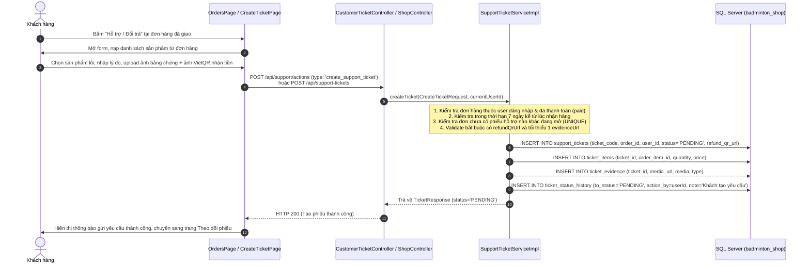
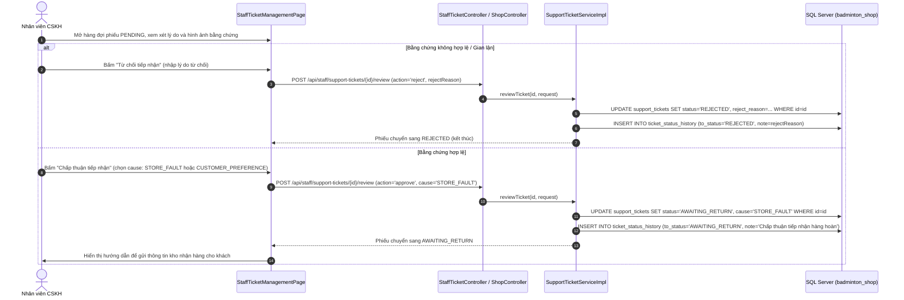
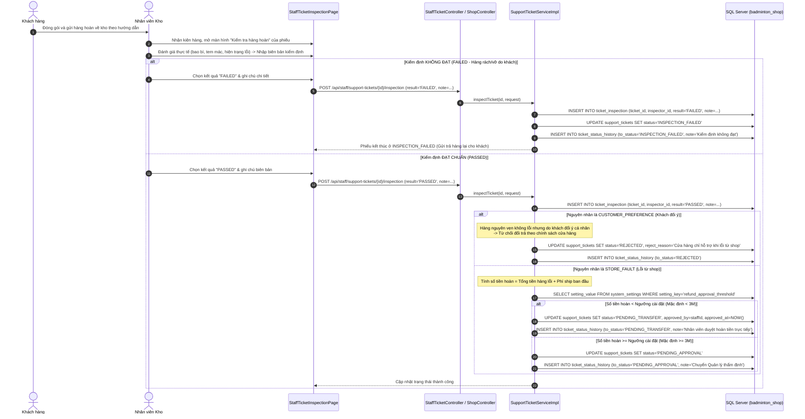
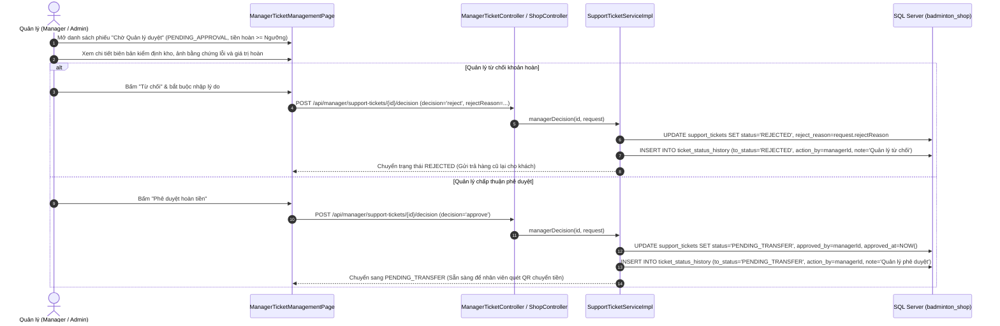
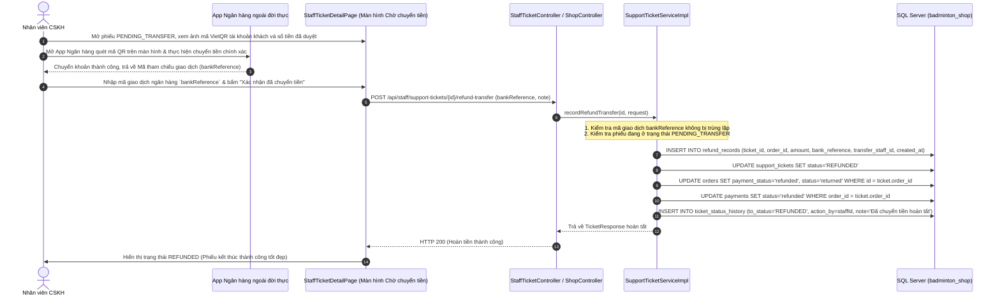
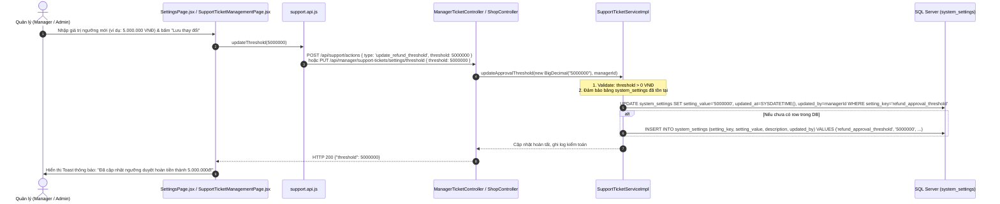

# TÀI LIỆU TOÀN DIỆN MODULE HỖ TRỢ ĐỔI TRẢ (SUPPORT TICKET: RETURNS & REFUNDS)

> **Dự án:** Badminton Shop Management System (SBA301_BadmintonShop_SE1986-JV)  
> **Phân hệ:** Support Ticket / Returns & Refunds (Khiếu nại, Trả hàng & Hoàn tiền)  
> **Kiến trúc:** RESTful Zero `/v1/` (`/api/support-tickets`, `/api/staff/support-tickets`, `/api/manager/support-tickets`) & Unified Shop Actions (`/api/support/actions`)
> **Ngày cập nhật:** 08/11/2026

---

## 1. TOÀN BỘ CÔNG NGHỆ ÁP DỤNG (TECHNOLOGY STACK)

### 1.1. Backend Framework & Ngôn ngữ

- **Java 21 LTS:** Tận dụng Virtual Threads, Pattern Matching for switch expressions và Records.
- **Spring Boot 3.3.x:** Khung ứng dụng doanh nghiệp chuẩn hóa với kiến trúc phân tầng (Controller -> Service -> Repository).
- **Spring Data JPA & Hibernate:** ORM quản lý quan hệ dữ liệu phức hợp giữa các thực thể:
  - `SupportTicket` (Phiếu hỗ trợ gốc)
  - `SupportTicketItem` (Danh sách sản phẩm yêu cầu hoàn tiền)
  - `TicketEvidence` (Hình ảnh/video bằng chứng lỗi)
  - `TicketInspection` (Biên bản thẩm định hiện trạng sản phẩm tại kho)
  - `TicketStatusHistory` (Nhật ký kiểm toán lịch sử thay đổi trạng thái và người thao tác)
  - `RefundRecord` (Chứng từ xác nhận chuyển khoản hoàn tiền thành công)
- **Spring JDBC (`JdbcTemplate`):** Quản lý cấu hình động bảng `system_settings`, tự động bootstrap bảng và thiết lập giá trị mặc định cho `refund_approval_threshold`.
- **Spring Security 6:** Phân quyền kiểm soát truy cập theo vai trò (Role-Based Access Control):
  - `CUSTOMER`: Chỉ tạo, xem và hủy phiếu của chính mình.
  - `STAFF`: Sơ duyệt, thẩm định hàng kho, duyệt hoàn tiền dưới hạn mức, quét QR chuyển tiền.
  - `MANAGER`, `ADMIN`: Thẩm định và phê duyệt các khoản hoàn tiền vượt hạn mức, điều chỉnh hạn mức Setting hệ thống.
- **Jakarta Bean Validation:** Xác thực ràng buộc dữ liệu đầu vào (`@NotNull`, `@NotBlank`, `@Size`, `@Min`).
- **Lombok:** Tự động sinh Getter, Setter, Builder, RequiredArgsConstructor.
- **Jackson FasterXML:** Xử lý JSON linh hoạt với Snake_case naming strategy.

### 1.2. Frontend Framework & Giao diện

- **React 18/19 & Vite:** Single-Page Application (SPA) hiệu năng cao, render giao diện tức thì.
- **React Router v6:** Điều hướng đa màn hình:
  - Khách hàng: `/support-tickets`, `/support-tickets/create?orderId=...`, `/support-tickets/:id`
  - Nhân viên: `/staff/support-tickets`, `/staff/support-tickets/:id`
  - Quản lý: `/manager/support-tickets`, `/management/settings`
- **React Bootstrap:** Thiết kế giao diện thân thiện, modal kiểm định kho, modal cập nhật ngưỡng duyệt hoàn tiền.
- **Context API (`ShopContext`, `AuthContext`):** Chia sẻ dữ liệu giỏ hàng, thông tin người dùng và phân quyền theo Token.
- **SweetAlert2 & Toast:** Thông báo trạng thái xử lý phiếu và xác nhận các thao tác quan trọng.
- **Xử lý Bằng chứng Đa phương tiện:** Hỗ trợ upload ảnh/video bằng chứng và bắt buộc tải lên ảnh mã VietQR tài khoản ngân hàng thụ hưởng.

### 1.3. Cơ sở dữ liệu (Database Schema)

- **Hệ quản trị CSDL:** Microsoft SQL Server 2019/2022.
- **Bảng dữ liệu phân hệ Support Ticket:**
  1. `support_tickets`: Thông tin chính của phiếu (mã phiếu, đơn hàng, khách hàng, lý do, trạng thái, nguyên nhân, số tiền hoàn, ảnh QR).
  2. `ticket_items`: Danh sách các item trong đơn hàng được chọn để hoàn trả kèm số lượng và đơn giá tại thời điểm mua.
  3. `ticket_evidence`: Lưu trữ URL các hình ảnh/video bằng chứng sản phẩm lỗi do khách gửi.
  4. `ticket_inspection`: Biên bản thẩm định của nhân viên kho khi nhận hàng hoàn (kết quả ĐẠT / KHÔNG ĐẠT, chi tiết tem mác, bao bì, trầy xước).
  5. `ticket_status_history`: Nhật ký vết kiểm toán (Audit Trail) lưu từ trạng thái cũ sang mới, ai thực hiện, ghi chú và thời gian.
  6. `refund_records`: Ghi nhận giao dịch hoàn tiền thực tế (mã giao dịch ngân hàng `bank_reference`, số tiền, nhân viên thực hiện, thời gian).
  7. `system_settings`: Lưu trữ giá trị cấu hình `refund_approval_threshold` (Ngưỡng hoàn tiền cần Quản lý phê duyệt - mặc định 3.000.000 VNĐ).

---

## 2. NGUYÊN TẮC CỐT LÕI & QUY TẮC NGHIỆP VỤ

1. **Phạm vi xử lý (Chỉ Trả hàng & Hoàn tiền - REFUND) & Cơ chế Tạo lại Ticket:**
   - Hệ thống chỉ tiếp nhận yêu cầu **Trả hàng & Hoàn tiền (`REFUND`)** đối với các đơn hàng đã thanh toán (`payment_status = 'paid'`) và đã giao thành công trong vòng **7 ngày**.
   - **Ràng buộc tiến trình:** Mỗi đơn hàng chỉ được phép tồn tại tối đa 1 phiếu hỗ trợ đang hoạt động (`PENDING`, `AWAITING_RETURN`, `PENDING_APPROVAL`, `PENDING_TRANSFER`).
   - **Cơ chế cho phép tạo lại ticket khi bị từ chối sơ duyệt:**
     - Nếu ticket bị từ chối ở bước **Sơ duyệt (`REJECTED`)** do ảnh mờ, bằng chứng chưa rõ ràng hoặc sai thông tin mã QR $\rightarrow$ Khách hàng **được phép tạo lại phiếu khiếu nại mới** (Tối đa **2 lần** cho 1 đơn hàng, không tính các phiếu khách tự hủy `CANCELLED`).
     - Nếu ticket đã bị từ chối sau bước **Kiểm định sản phẩm thực tế tại kho (`INSPECTION_FAILED` hoặc `REJECTED` sau khi hàng hoàn về tới kho)** $\rightarrow$ Đây là phán quyết vật lý cuối cùng, hệ thống **chặn vĩnh viễn không cho tạo lại**.
     - Đơn hàng đã hoàn tiền thành công (`REFUNDED`) $\rightarrow$ Khóa không cho tạo thêm phiếu mới.
2. **Bắt buộc tải ảnh mã QR ngân hàng nhận tiền:**
   - Khách hàng bắt buộc upload ảnh mã VietQR tài khoản ngân hàng thụ hưởng. Không cho phép nhập tay STK/ngân hàng để triệt tiêu lỗi gõ nhầm.
   - Bắt buộc đính kèm tối thiểu 1 hình ảnh/video minh chứng lỗi sản phẩm.
3. **Chính sách hoàn tiền theo nguyên nhân phát sinh:**
   - **Lỗi từ phía Cửa hàng (`STORE_FAULT`):** Giao sai mẫu, sai thông số kỹ thuật, nứt gãy, bong tróc hoặc hư hỏng do vận chuyển $\rightarrow$ Cửa hàng chấp thuận hoàn 100% tiền hàng và phí vận chuyển ban đầu.
   - **Khách đổi ý / nhu cầu cá nhân (`CUSTOMER_PREFERENCE`):** Sau khi hàng hoàn về tới kho và kiểm định đạt chuẩn nhưng nguyên nhân là do khách đổi ý $\rightarrow$ Hệ thống sẽ **Từ chối phiếu (`REJECTED`)**, gửi trả lại sản phẩm cho khách và **không hoàn tiền**.
   - **Không nhập lại kho (`No Restock`):** Hàng lỗi thu hồi được chuyển bảo hành hoặc tiêu hủy, không cộng lại vào kho bán đại trà.
4. **Phân quyền duyệt hoàn tiền theo hạn mức linh hoạt (`refund_approval_threshold`):**
   - Mặc định là **3.000.000 VNĐ**, Quản lý (`MANAGER`, `ADMIN`) có thể linh hoạt điều chỉnh tại trang **Cài đặt hệ thống (`/management/settings`)** hoặc modal cấu hình nhanh.
   - **Số tiền hoàn < Ngưỡng cài đặt:** Nhân viên sau khi kiểm tra hàng hoàn đạt chuẩn có quyền trực tiếp phê duyệt (`approve-refund`), phiếu chuyển ngay sang chờ chuyển tiền (`PENDING_TRANSFER`).
   - **Số tiền hoàn >= Ngưỡng cài đặt:** Phiếu tự động chuyển sang hàng đợi Quản lý (`PENDING_APPROVAL`). Chỉ Quản lý mới có quyền phê duyệt hoặc từ chối.
5. **Hoàn tiền thủ công qua quét mã QR (Manual QR Transfer):**
   - Nhân viên CSKH mở App ngân hàng quét trực tiếp ảnh mã VietQR của khách, chuyển đúng số tiền đã duyệt, sau đó nhập **Mã giao dịch ngân hàng (`bank_reference`)** để hoàn tất phiếu.

---

## 3. LUỒNG DỮ LIỆU CHI TIẾT (DATA FLOW BREAKDOWN)

### 3.1. Ma trận chuyển dịch dữ liệu (Data & Entity Mutation Matrix)

| Giai đoạn                                | Bảng bị tác động        | Cột thay đổi / Giá trị                                                                                                            | Nguồn sinh dữ liệu                                            |
| :--------------------------------------- | :---------------------- | :-------------------------------------------------------------------------------------------------------------------------------- | :------------------------------------------------------------ |
| **1. Khách tạo phiếu**                   | `support_tickets`       | `INSERT`: `ticket_code`, `order_id`, `user_id`, `type='REFUND'`, `status='PENDING'`, `reason`, `refund_qr_url`, `created_at`      | Form khách gửi trên `/support-tickets/create`                 |
|                                          | `ticket_items`          | `INSERT`: `ticket_id`, `order_item_id`, `quantity`, `price`                                                                       | Sản phẩm lỗi khách chọn trong đơn                             |
|                                          | `ticket_evidence`       | `INSERT`: `ticket_id`, `media_url`, `media_type`                                                                                  | Danh sách ảnh/video bằng chứng khách tải lên                  |
|                                          | `ticket_status_history` | `INSERT`: `from_status=NULL`, `to_status='PENDING'`, `action_by=userId`                                                           | Khởi tạo lịch sử phiếu                                        |
| **2. Sơ duyệt tiếp nhận (SLA 48h)**      | `support_tickets`       | `UPDATE`: `status='AWAITING_RETURN'` (hoặc `'REJECTED'`), `cause`, `staff_note`                                                   | Nhân viên CSKH đánh giá sơ bộ hồ sơ                           |
|                                          | `ticket_status_history` | `INSERT`: `from_status='PENDING'`, `to_status='AWAITING_RETURN'`, `action_by=staffId`                                             | Ghi nhận sơ duyệt                                             |
| **3. Khách gửi hàng & Kiểm định kho**    | `ticket_inspection`     | `INSERT`: `ticket_id`, `inspector_id`, `result` (`PASSED`/`FAILED`), `note`                                                       | Nhân viên kho nhận kiện hàng và lập biên bản                  |
|                                          | `support_tickets`       | `UPDATE`: `status='INSPECTION_FAILED'` nếu không đạt; hoặc phân nhánh theo `cause` và ngưỡng tiền nếu đạt                         | Hệ thống tự động tính toán                                    |
|                                          | `ticket_status_history` | `INSERT`: Ghi lại kết quả kiểm định hàng hoàn                                                                                     | Audit log                                                     |
| **4. Phê duyệt hoàn tiền**               | `support_tickets`       | `UPDATE`: `status='PENDING_TRANSFER'`, `refund_amount`, `approved_by`, `approved_at=NOW()`                                        | Staff duyệt (nếu < ngưỡng) hoặc Quản lý duyệt (nếu >= ngưỡng) |
|                                          | `ticket_status_history` | `INSERT`: Ghi lại ai đã duyệt khoản tiền hoàn                                                                                     | Audit log                                                     |
| **5. Quét QR chuyển tiền & Kết thúc**    | `refund_records`        | `INSERT`: `ticket_id`, `order_id`, `amount`, `bank_reference`, `transfer_staff_id`, `created_at`                                  | Nhân viên nhập mã giao dịch ngân hàng thực tế                 |
|                                          | `support_tickets`       | `UPDATE`: `status='REFUNDED'`                                                                                                     | Đánh dấu hoàn tất toàn bộ quy trình                           |
|                                          | `orders`                | `UPDATE`: `payment_status='refunded'`, `status='returned'`                                                                        | Đồng bộ trạng thái đơn hàng                                   |
|                                          | `payments`              | `UPDATE`: `status='refunded'`                                                                                                     | Đồng bộ trạng thái thanh toán                                 |
|                                          | `ticket_status_history` | `INSERT`: `from_status='PENDING_TRANSFER'`, `to_status='REFUNDED'`, `action_by=staffId`                                           | Ghi nhận hoàn tiền thành công                                 |
| **6. Quản lý điều chỉnh Ngưỡng Setting** | `system_settings`       | `UPDATE`/`INSERT`: `setting_key='refund_approval_threshold'`, `setting_value`, `updated_at=SYSDATETIME()`, `updated_by=managerId` | Quản lý lưu ngưỡng mới tại `/management/settings`             |

---

## 4. SƠ ĐỒ LUỒNG DỮ LIỆU & TUẦN TỰ (SEQUENCE DIAGRAMS)

### 4.1. Luồng 1: Khách hàng tạo phiếu yêu cầu Đổi trả & Hoàn tiền



---

### 4.2. Luồng 2: Nhân viên CSKH sơ duyệt tiếp nhận (SLA 48h)



---

### 4.3. Luồng 3: Khách gửi hàng hoàn & Nhân viên kho lập biên bản kiểm định



---

### 4.4. Luồng 4: Quản lý thẩm định & Phê duyệt khoản hoàn tiền lớn (>= Ngưỡng Setting)



---

### 4.5. Luồng 5: Nhân viên quét mã VietQR chuyển tiền & Hoàn tất phiếu



---

### 4.6. Luồng 6: Quản lý điều chỉnh giá trị Setting ngưỡng phê duyệt (`refund_approval_threshold`)



---

## 5. MA TRẬN 8 TRẠNG THÁI VÒNG ĐỜI SUPPORT TICKET (STATE TRANSITIONS)

```
[Khách tạo phiếu]
       │
       ▼
    PENDING ──(Khách chủ động hủy)──> CANCELLED
       │
       ├──(Staff từ chối sơ duyệt)──> REJECTED
       │
       └──(Staff chấp thuận sơ duyệt)──> AWAITING_RETURN
                                               │
               ┌───────────────────────────────┴───────────────────────────────┐
               ▼                                                               ▼
        [Kiểm định FAILED]                                              [Kiểm định PASSED]
               │                                                               │
        INSPECTION_FAILED                                     ┌────────────────┴────────────────┐
                                                              ▼                                 ▼
                                                   [Khách đổi ý/không lỗi]             [Lỗi do shop STORE_FAULT]
                                                              │                                 │
                                                           REJECTED                 ┌───────────┴───────────┐
                                                                                    ▼                       ▼
                                                                             [Tiền hoàn < Ngưỡng]   [Tiền hoàn >= Ngưỡng]
                                                                                    │                       │
                                                                            (Staff duyệt ngay)       PENDING_APPROVAL
                                                                                    │                       │
                                                                                    │               (Manager duyệt)
                                                                                    │                       │
                                                                                    ▼                       ▼
                                                                            PENDING_TRANSFER <──────────────┘
                                                                                    │
                                                                           (Staff quét QR chuyển tiền)
                                                                                    │
                                                                                    ▼
                                                                                 REFUNDED
```

| Trạng thái          | Tên tiếng Việt          | Quyền thao tác      | Ý nghĩa & Điều kiện chuyển tiếp                                                                                        |
| :------------------ | :---------------------- | :------------------ | :--------------------------------------------------------------------------------------------------------------------- |
| `PENDING`           | Chờ tiếp nhận sơ duyệt  | Khách hàng, Staff   | Phiếu vừa tạo. Khách có thể bấm **Hủy (`CANCELLED`)**. Staff duyệt chuyển `AWAITING_RETURN` hoặc từ chối `REJECTED`.   |
| `AWAITING_RETURN`   | Chờ khách gửi lại hàng  | Khách hàng, Staff   | Khách đóng gói gửi hàng về kho shop. Nhân viên kho nhận hàng và lập biên bản kiểm định.                                |
| `INSPECTION_FAILED` | Kiểm tra hàng không đạt | -                   | Trạng thái kết thúc. Hàng rách/hỏng do lỗi người dùng. Gửi trả lại khách, chặn hoàn tiền.                              |
| `PENDING_APPROVAL`  | Chờ Quản lý duyệt       | Quản lý (`MANAGER`) | Hàng đạt chuẩn do lỗi shop nhưng số tiền hoàn $\ge$ Ngưỡng cài đặt. Quản lý duyệt hoặc từ chối.                        |
| `PENDING_TRANSFER`  | Chờ chuyển tiền         | Nhân viên (`STAFF`) | Khoản hoàn đã được duyệt. Chờ Staff mở App ngân hàng quét QR của khách để chuyển tiền.                                 |
| `REFUNDED`          | Đã hoàn tiền            | -                   | Trạng thái kết thúc. Staff nhập mã giao dịch ngân hàng thành công. Ghi nhận bảng `refund_records`.                     |
| `REJECTED`          | Bị từ chối              | -                   | Trạng thái kết thúc. Bị từ chối ở bước sơ duyệt, hoặc do khách đổi ý (`CUSTOMER_PREFERENCE`), hoặc do Quản lý từ chối. |
| `CANCELLED`         | Khách đã hủy            | -                   | Trạng thái kết thúc. Khách chủ động hủy khi phiếu còn ở trạng thái `PENDING`.                                          |

---

## 6. DANH MỤC API SPECIFICATIONS MODULE SUPPORT TICKET (ZERO `/v1/`)

### 6.1. Dành cho Khách hàng (`/api/support-tickets` & `/api/support/actions`)

| Method | Endpoint                           | Quyền truy cập         | Mục đích nghiệp vụ                                                         |
| :----- | :--------------------------------- | :--------------------- | :------------------------------------------------------------------------- |
| `POST` | `/api/support/actions`             | `CUSTOMER` (Chính chủ) | Tạo phiếu qua action `{ "type": "create_support_ticket", ... }`            |
| `POST` | `/api/support-tickets`             | `CUSTOMER` (Chính chủ) | Khách hàng tạo phiếu yêu cầu Trả hàng & Hoàn tiền kèm ảnh QR và bằng chứng |
| `GET`  | `/api/support-tickets`             | `CUSTOMER` (Chính chủ) | Khách hàng xem danh sách phiếu hỗ trợ của tài khoản mình                   |
| `GET`  | `/api/support-tickets/{id}`        | `CUSTOMER` (Chính chủ) | Khách hàng xem chi tiết tiến trình xử lý phiếu hỗ trợ                      |
| `POST` | `/api/support-tickets/{id}/cancel` | `CUSTOMER` (Chính chủ) | Khách hàng hủy yêu cầu hỗ trợ (chỉ khi phiếu đang ở trạng thái `PENDING`)  |

### 6.2. Dành cho Nhân viên CSKH & Kho (`/api/staff/support-tickets`)

| Method | Endpoint                                          | Quyền truy cập              | Mục đích nghiệp vụ                                                         |
| :----- | :------------------------------------------------ | :-------------------------- | :------------------------------------------------------------------------- |
| `GET`  | `/api/staff/support-tickets`                      | `STAFF`, `MANAGER`, `ADMIN` | Xem hàng đợi danh sách ticket cần xử lý (lọc theo `status`, `type`)        |
| `GET`  | `/api/staff/support-tickets/{id}`                 | `STAFF`, `MANAGER`, `ADMIN` | Xem chi tiết thông tin và biên bản kiểm định của 1 phiếu                   |
| `POST` | `/api/staff/support-tickets/{id}/review`          | `STAFF`, `MANAGER`, `ADMIN` | Sơ duyệt tiếp nhận (SLA 48h): duyệt chọn `cause` hoặc từ chối              |
| `POST` | `/api/staff/support-tickets/{id}/inspection`      | `STAFF`, `MANAGER`, `ADMIN` | Ghi nhận biên bản thẩm định hàng tại kho (`PASSED` / `FAILED`)             |
| `POST` | `/api/staff/support-tickets/{id}/approve-refund`  | `STAFF`, `MANAGER`, `ADMIN` | Nhân viên phê duyệt hoàn tiền (áp dụng cho khoản hoàn dưới Ngưỡng cài đặt) |
| `POST` | `/api/staff/support-tickets/{id}/refund-transfer` | `STAFF`, `MANAGER`, `ADMIN` | Nhân viên quét ảnh QR chuyển tiền và lưu mã giao dịch `bankReference`      |

### 6.3. Dành cho Quản lý (`/api/manager/support-tickets`)

| Method | Endpoint                                          | Quyền truy cập     | Mục đích nghiệp vụ                                                                    |
| :----- | :------------------------------------------------ | :----------------- | :------------------------------------------------------------------------------------ |
| `POST` | `/api/manager/support-tickets/{id}/decision`      | `MANAGER`, `ADMIN` | Quản lý phê duyệt (`approve`) hoặc từ chối (`reject`) khoản hoàn $\ge$ Ngưỡng cài đặt |
| `GET`  | `/api/manager/support-tickets/settings/threshold` | `MANAGER`, `ADMIN` | Xem ngưỡng phê duyệt hoàn tiền hiện tại của hệ thống (mặc định 3.000.000 VNĐ)         |
| `PUT`  | `/api/manager/support-tickets/settings/threshold` | `MANAGER`, `ADMIN` | Cập nhật ngưỡng phê duyệt hoàn tiền mới (áp dụng ngay vào các phiếu tiếp theo)        |
